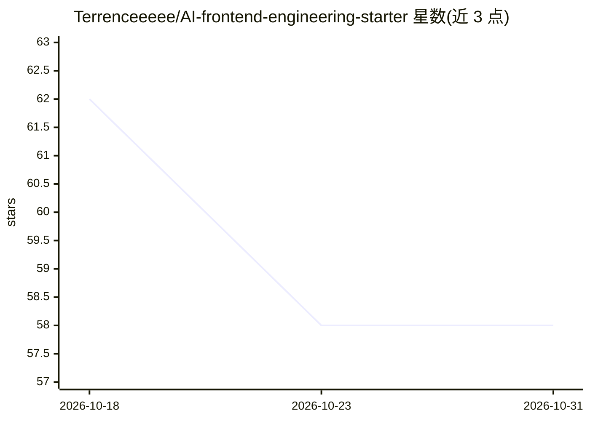

# Terrenceeeee/AI-frontend-engineering-starter

⭐ 58 · TypeScript · MIT · 推送 2026-10-16 · [GitHub](https://github.com/Terrenceeeee/AI-frontend-engineering-starter) · [官网](https://terrenceeeee.github.io/AI-frontend-engineering-starter/) · 个人维护 · 中文 README

**前端工程化实战项目集：Vue3+TS 全链路 Demo 与 AI 辅助审查**

基于 Vue 3 + TypeScript + Vite + pnpm 的前端工程化最小可行产品，以 34 个 Demo 覆盖代码规范、构建分包、CI/CD、Vitest/Playwright 测试、性能监控（Web Vitals）、请求池/重试、Service Worker 离线缓存等环节，并提供部署与一键回滚脚本。AI 部分包括知识图谱生成（ts-morph+d3.js）、AI Code Review 与 ESLint 自动修复 Agent，需配置 DEEPSEEK_API_KEY。面向初中级前端开发者的进阶学习与团队基建参考，提供 GitHub Pages 在线演示与可复用资产清单。

## 筛选速览

| 维度 | 判定 | 备注 |
|---|---|---|
| AI 角色 | `ai-enhanced` | 去掉 AI 部分产品仍成立 |
| 许可风险 | `permissive` | MIT |
| 部署形态 | `library` | 以包/库形式分发 |
| 模型依赖 | — | README 未给出锁定关系 |
| 硬件要求 | — | 无带数字的原话,不猜 |
| 安装摩擦 | `low` | 无编译、无系统依赖或容器化 |
| 成熟度 | — | 结构信号不足 |

## 能力要点

- 路由懒加载+manualChunks 分包、CDN 与缓存控制
- Vitest/Playwright 测试与 GitHub Actions CI/CD 全流程
- ts-morph 静态分析+d3.js 知识图谱可视化
- DeepSeek API 驱动的 AI Code Review 与 Agent 自动修复

## 适用场景

- 系统学习从编码到部署监控的前端工程化全链路
- 搭建团队工程化基础设施时复制工具函数与配置文件
- 用 AI Code Review 分析改动影响范围并生成评审意见

## 场景标签

`代码审查` `知识图谱` `教程课程` · 领域:编码与开发

## 证据(README 行号)

> L15: 本仓库实现了一套**前端工程化最小可行产品（MVP）**，技术栈基于 **Vue 3 + TypeScript + Vite + pnpm**，系统完整演示了从本地代码开发到线上运维的全链路工程化实践。
> L116:  AI Code Review 三种方式：
> L17: 项目覆盖包管理、代码规范、构建优化、自动化脚本、CI/CD 流水线、单元测试与 E2E 测试、性能监控、调试工具链、请求治理、离线缓存、AI 辅助开发等前端工程化核心领域，通过 Demo1、Demo2 两套示例完成流程验证。当前可

## 星数曲线

2026-10-18 62 → 2026-10-31 58（-4）

---
*卡片 v1 · prompt 1.4 · 生成 2026-10-24 · 置信度 high · 依据 README sha `3a157c23f726` · [字段定义](../../DATASET.md)*
