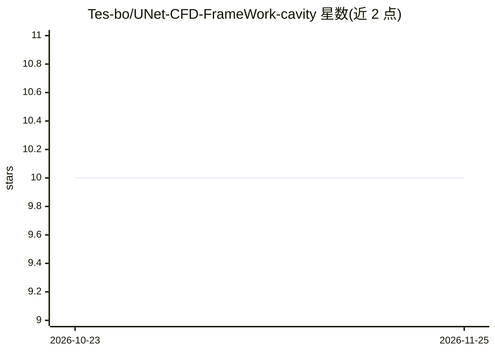

# Tes-bo/UNet-CFD-FrameWork-cavity

⭐ 10 · C++ · GPL-3.0 · 推送 2026-08-29 · [GitHub](https://github.com/Tes-bo/UNet-CFD-FrameWork-cavity) · 个人维护 · 中文 README

**用 U-Net 学习边界条件到腔体流场映射的科研框架**

基于 PyTorch 的科研训练框架：先用 OpenFOAM 自动生成不同 lid 速度与雷诺数下的腔体流 CFD 数据（128×128 网格 .npz），再训练 6 层编码-解码 U-Net（跳连、L1 损失、Adam）学习边界条件到压力/速度场的映射，最后对测试集生成预测对比图。支持 DataParallel 多卡训练与早停，提供一键 run_all.sh 脚本、可调参数（样本数/迭代数/网络规模）及 GPU 显存配置表。运行依赖 OpenFOAM v2412，200 样本数据生成约需 30-60 分钟。

## 筛选速览

| 维度 | 判定 | 备注 |
|---|---|---|
| AI 角色 | `ai-native` | 本体是模型或模型工具 |
| 许可风险 | `viral` | GPL-3.0 |
| 部署形态 | `library` | 以包/库形式分发 |
| 模型依赖 | — | README 未给出锁定关系 |
| 硬件要求 | — | 无带数字的原话,不猜 |
| 安装摩擦 | `medium` | 含编译或系统依赖之一 |
| 成熟度 | — | 结构信号不足 |

## 能力要点

- OpenFOAM 自动生成参数化 CFD 训练集（默认 200 样本，70/15/15 划分）
- 6 层 U-Net（跳连 + BatchNorm + L1 损失）预测压力与速度场
- DataParallel 多 GPU 训练与早停
- 三档资源配置预设与显存需求对照表

## 适用场景

- 训练边界条件到腔体流场的代理模型
- 替代重复 CFD 仿真获得快速流场预测（README 称推理 <0.05 秒/样本）
- 复现 U-Net + CFD 数据驱动的科研实验流程

## 场景标签

`科研工具` · 领域:学习与行业

## 证据(README 行号)

> L16: This project trains a U-Net neural network to learn the mapping from boundary conditions (lid velocity and Reynolds
> L27: - **U-Net Architecture**: 6-layer encoder-decoder network with skip connections

## 星数曲线

2026-10-23 10 → 2026-11-25 10（+0）

---
*卡片 v1 · prompt 1.4 · 生成 2026-11-20 · 置信度 high · 依据 README sha `512ebde4fba4` · [字段定义](../../DATASET.md)*
