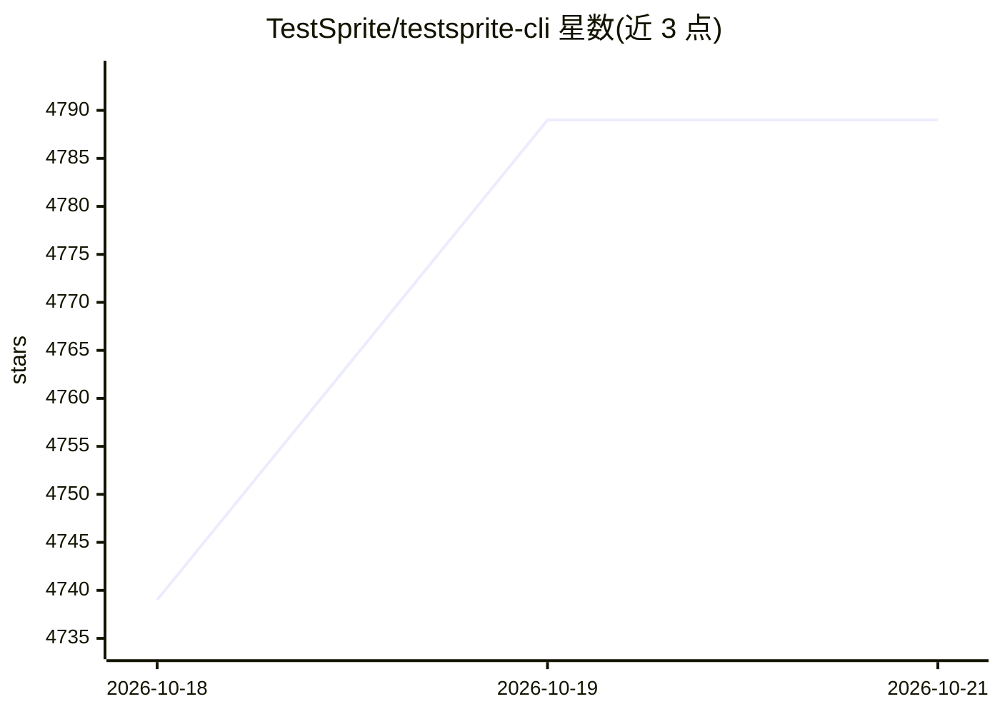

# TestSprite/testsprite-cli

⭐ 4,789 · TypeScript · Apache-2.0 · 推送 2026-10-19 · [GitHub](https://github.com/TestSprite/testsprite-cli) · [官网](https://www.testsprite.com) · 组织维护

**TestSprite 官方 CLI：让编码 agent 用自然语言计划生成并运行测试**

TestSprite AI 测试平台的官方命令行客户端，面向使用编码 agent 的开发者。通过 `testsprite setup` 为 Claude Code、Cursor、Cline、Codex 等 8 种编码 agent 安装验证技能，使 agent 能自主创建、运行和分诊测试；测试计划以 JSON 自然语言描述，无需编写浏览器代码，平台在云端对真实运行的应用执行前端/后端测试。本地应用可经 TestSprite 隧道接入（含 Free 计划），隧道控制与数据面均走 TLS；需 API key，计划生成与 PRD 嵌入消耗工作区积分。要求 Node.js 20.19+/22.13+/24+。

## 筛选速览

| 维度 | 判定 | 备注 |
|---|---|---|
| AI 角色 | `ai-ecosystem` | LLM/agent 周边工具 |
| 许可风险 | `permissive` | Apache-2.0 |
| 部署形态 | `library` | 以包/库形式分发 |
| 模型依赖 | — | README 未给出锁定关系 |
| 硬件要求 | — | 无带数字的原话,不猜 |
| 安装摩擦 | `low` | 无编译、无系统依赖或容器化 |
| 成熟度 | — | 结构信号不足 |

## 能力要点

- 一条命令为 8 种编码 agent 安装验证技能
- JSON 自然语言测试计划，无需编写浏览器代码
- 本地前端测试经 TestSprite 隧道接入（Free 计划可用，默认并发 5、可调 1-10）
- `testsprite test plan generate` 可探索应用并起草测试提案供审阅采纳

## 适用场景

- 让我的编码 agent 在交付前自行运行测试并修复问题
- 在 CI 中非交互式接入 TestSprite 测试平台
- 对本地运行的 dev server 做云端前端测试

## 场景标签

`代码生成` · 领域:编码与开发

## 证据(README 行号)

> L33: TestSprite is the AI testing platform 100,000+ teams use to test their software, frontend and backend — in the clou
> L35: It puts that platform in your coding agent's hands: the agent verifies every behavior it ships, and what broke come
> L52: `testsprite setup` prompts for your API key, verifies it, and installs the verification-loop skill for the coding a

## 星数曲线

2026-10-18 4,739 → 2026-10-21 4,789（+50）

---
*卡片 v1 · prompt 1.4 · 生成 2026-10-20 · 置信度 high · 依据 README sha `26fa4b902488` · [字段定义](../../DATASET.md)*
