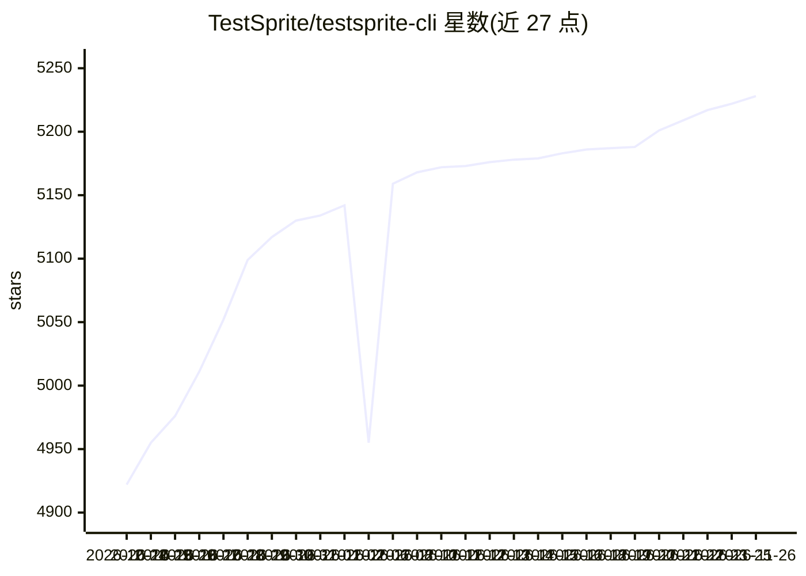

# TestSprite/testsprite-cli

⭐ 5,228 · TypeScript · Apache-2.0 · 推送 2026-11-25 · [GitHub](https://github.com/TestSprite/testsprite-cli) · [官网](https://www.testsprite.com) · 组织维护

**面向开发者的 AI 自动化测试 CLI：云端对真实应用执行测试**

TestSprite 平台的官方命令行工具，将云端 AI 测试能力接入终端与编码 agent。流程为 plan → apply → run → result get：由平台 agent 生成测试计划，对运行中的前端或后端执行真实浏览器/API 测试，结果以 JSON 返回失败步骤、原因与修复建议，agent 可据此修复代码后重跑。需要 Node.js 20.19+，通过工作区 API key 认证，测试在云端执行，本地测试经隧道连接。支持 CI 集成与 PR 门禁。

## 筛选速览

| 维度 | 判定 | 备注 |
|---|---|---|
| AI 角色 | `ai-native` | 本体是模型或模型工具 |
| 许可风险 | `permissive` | Apache-2.0 |
| 部署形态 | `library` | 以包/库形式分发 |
| 模型依赖 | — | README 未给出锁定关系 |
| 硬件要求 | — | 无带数字的原话,不猜 |
| 安装摩擦 | `low` | 无编译、无系统依赖或容器化 |
| 成熟度 | — | 结构信号不足 |

## 能力要点

- 对云端真实浏览器/API 执行测试，输出含截图、视频等证据的单条结果
- testsprite setup 自动为检测到的编码 agent 安装技能文件
- GitHub Actions PR 门禁与 JUnit 报告输出
- 本地端口经隧道由云端 runner 执行测试

## 适用场景

- 让编码 agent 在提交代码前自动验证行为是否正常
- 在 CI 中为每个 PR 运行测试门禁
- 对本地 3000 端口运行的前端执行保存的测试

## 场景标签

 · 领域:软件测试/QA 工具

## 证据(README 行号)

> L33: TestSprite is the AI testing platform 100,000+ teams use to test their software, frontend and backend — in the clou
> L35: It puts that platform in your coding agent's hands: the agent verifies every behavior it ships, and what broke come
> L127: - **Not yet covered** → `testsprite plan` — the project's agent writes a test for the new behavior; `testsprite ap

## 星数曲线

2026-10-24 4,922 → 2026-11-26 5,228（+306）

---
*卡片 v1 · prompt 1.4 · 生成 2026-11-22 · 置信度 mid · 依据 README sha `653c6e407874` · [字段定义](../../DATASET.md)*
