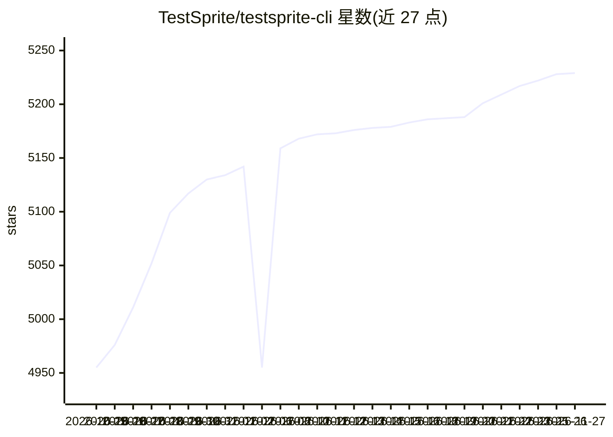

# TestSprite/testsprite-cli

⭐ 5,229 · TypeScript · Apache-2.0 · 推送 2026-11-26 · [GitHub](https://github.com/TestSprite/testsprite-cli) · [官网](https://www.testsprite.com) · 组织维护

**编码 agent 的自动化测试 CLI：验证 AI 写的代码是否可用**

TestSprite 云端测试平台的官方命令行工具：对运行中的前端或后端做真实浏览器/API 测试，测试由云端 agent 生成与执行，结果以面向编码 agent 的结构化 JSON 返回（失败步骤、原因、修复建议、截图与视频证据）。通过 plan→apply→run→result get 的循环将验证结果沉淀为持久测试套件，支持 GitHub Actions PR 门禁、JUnit 报告与本地环境隧道。需 Node.js 20.19+，依赖云端服务运行。

## 筛选速览

| 维度 | 判定 | 备注 |
|---|---|---|
| AI 角色 | `ai-ecosystem` | LLM/agent 周边工具 |
| 许可风险 | `permissive` | Apache-2.0 |
| 部署形态 | `library` | 以包/库形式分发 |
| 模型依赖 | — | README 未给出锁定关系 |
| 硬件要求 | — | 无带数字的原话,不猜 |
| 安装摩擦 | `low` | 无编译、无系统依赖或容器化 |
| 成熟度 | — | 结构信号不足 |

## 能力要点

- 针对编码 agent 的结果输出：每次运行返回失败步骤、原因与修复建议及截图/视频证据
- plan→apply→run→result get→fix 循环，通过的测试累积为持久测试套件
- testsprite setup 自动为检测到的编码 agent 安装技能文件
- ci init github 生成 PR 门禁，支持 JUnit 报告与机器可读摘要

## 适用场景

- 让编码 agent 在提交代码前自动验证行为是否被测试覆盖
- 在 GitHub Actions 中对每个 PR 的预览部署运行测试套件
- 通过隧道对本地运行的前端应用执行云端测试

## 场景标签

`代码审查` `编码 Agent` · 领域:编码与开发

## 证据(README 行号)

> L33: TestSprite is the AI testing platform 100,000+ teams use to test their software, frontend and backend — in the clou
> L35: It puts that platform in your coding agent's hands: the agent verifies every behavior it ships, and what broke come
> L122: - 🔌 **One command to onboard your agent.** `testsprite setup` drops ready-made skill files into your repo — for th

## 星数曲线

2026-10-25 4,955 → 2026-11-27 5,229（+274）

---
*卡片 v1 · prompt 1.4 · 生成 2026-11-27 · 置信度 high · 依据 README sha `399160f96ac8` · [字段定义](../../DATASET.md)*
