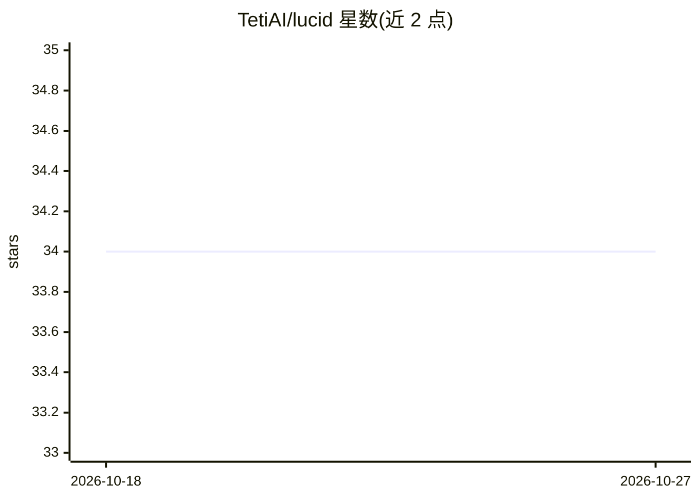

# TetiAI/lucid

⭐ 34 · TypeScript · BSD-3-Clause · 推送 2026-07-06 · [GitHub](https://github.com/TetiAI/lucid) · [官网](https://teti.ai/hub/lucid) · 组织维护

**检测用户认知依赖并自适应调整 AI 回复的 SDK**

嵌入在用户与 AI 交互之间的 TypeScript/npm SDK：通过 track() 记录每次交互，按 6 个基于心理测量量表的认知维度（自主性、学习、参与、元认知、验证、动机）评分，检测随时间的认知漂移（CDI），并经 getGuidelines() 生成注入系统提示词的自适应指令，实现渐进式脚手架（full→guided→hints→challenge）。使用 openai SDK 作为通用客户端，支持任意 LLM 提供商与小模型，分析为异步不阻塞响应。存储层可插拔（内存/SQLite/Postgres/MySQL/Prisma/Redis），不存储消息内容仅存聚合指标，提供 deleteUser() 满足 GDPR。面向 AI 聊天产品、EdTech 平台、企业 AI 工具与面向未成年人的应用。

## 筛选速览

| 维度 | 判定 | 备注 |
|---|---|---|
| AI 角色 | `ai-ecosystem` | LLM/agent 周边工具 |
| 许可风险 | `permissive` | BSD-3-Clause |
| 部署形态 | `library` | 以包/库形式分发 |
| 模型依赖 | local-ok | 支持本地模型 |
| 硬件要求 | — | 无带数字的原话,不猜 |
| 安装摩擦 | `low` | 无编译、无系统依赖或容器化 |
| 成熟度 | — | 结构信号不足 |

## 能力要点

- 6 个认知维度评分与认知漂移指数（CDI）检测
- getGuidelines() 生成注入系统提示词的自适应指令
- 渐进式脚手架四级衰减（full→guided→hints→challenge）
- track() 异步 fire-and-forget，不阻塞响应；不存储消息内容

## 适用场景

- AI 聊天产品监测用户是否过度依赖 AI 并调整回复方式
- 教育平台在学生使用 AI 时保护学习成效
- 面向未成年人的 AI 应用按年龄段分层保护

## 场景标签

`提示工程` · 领域:Agent 开发

## 证据(README 行号)

> L13: Lucid monitors user-AI interactions across 6 research-backed cognitive dimensions, detects drift over time, and inj
> L86: - **Zero latency** — `track()` is fire-and-forget, never blocks the AI response

## 星数曲线

2026-10-18 34 → 2026-10-27 34（+0）

---
*卡片 v1 · prompt 1.4 · 生成 2026-10-25 · 置信度 high · 依据 README sha `84591d1e5b3a` · [字段定义](../../DATASET.md)*
