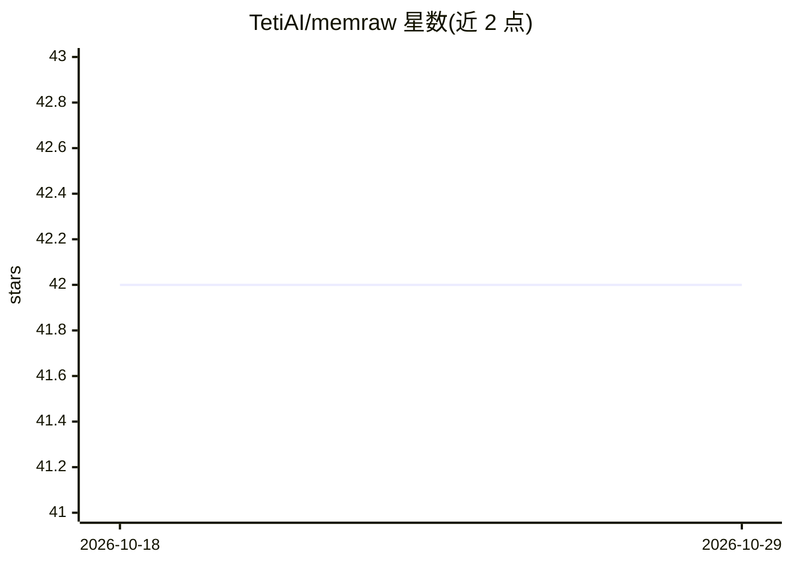

# TetiAI/memraw

⭐ 42 · TypeScript · Apache-2.0 · 推送 2026-07-10 · [GitHub](https://github.com/TetiAI/memraw) · 组织维护

**AI agent 记忆实验库：全文记忆直接置于 prompt，不做检索**

面向 AI agent 开发者的记忆系统 npm 库（v0.0.1 实验阶段）：不使用嵌入与向量库，把对话蒸馏为带 1–9 重要度评分的事实行，整体作为纯文本放入 prompt；容量满时按重要度而非时间淘汰，提供 consolidate() 按'山谷'排列与 narrate() 按需生成散文视图。零依赖，唯一外部调用是 agent 已用的 LLM（任意 OpenAI 兼容端点），无 key 也可运行（仅蒸馏与评分需要 LLM）。附 CLI 与 MCP server。作者声明这是实验而非产品，预期有破坏性变更。

## 筛选速览

| 维度 | 判定 | 备注 |
|---|---|---|
| AI 角色 | `ai-ecosystem` | LLM/agent 周边工具 |
| 许可风险 | `permissive` | Apache-2.0 |
| 部署形态 | `library` | 以包/库形式分发 |
| 模型依赖 | — | README 未给出锁定关系 |
| 硬件要求 | — | 无带数字的原话,不猜 |
| 安装摩擦 | `low` | 无编译、无系统依赖或容器化 |
| 成熟度 | `idea` | |

## 能力要点

- 事实行带 1–9 重要度评分，按重要度遗忘而非按时间
- 零依赖、无向量库，记忆是单个纯文本字符串，只追加以适配 prompt 缓存
- consolidate() 山谷排列与 narrate() 按需散文视图（≤50% 事实量）
- 提供 CLI 与 MCP server，兼容任意 OpenAI 兼容端点

## 适用场景

- 给 AI agent 提供始终在 prompt 中的长期记忆
- 替代检索式记忆方案做实验对比
- 通过 Claude Code / Cursor 的 MCP 接入持久记忆

## 场景标签

`Agent 记忆` · 领域:Agent 开发

## 证据(README 行号)

> L7:  An open experiment in memory for AI agents — the whole memory, always in the prompt.
> L18: - **No embeddings, no vector DB, no infra of its own.** A memory is one
> L20:  the only external call is the LLM your agent already uses.

## 星数曲线

2026-10-18 42 → 2026-10-29 42（+0）

---
*卡片 v1 · prompt 1.4 · 生成 2026-10-25 · 置信度 high · 依据 README sha `8376f77b5dbc` · [字段定义](../../DATASET.md)*
