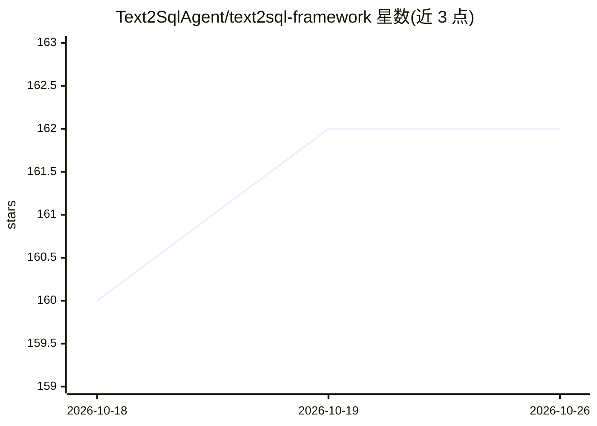

# Text2SqlAgent/text2sql-framework

⭐ 162 · Python · MIT · 推送 2026-08-18 · [GitHub](https://github.com/Text2SqlAgent/text2sql-framework) · 组织维护

**Agentic text-to-SQL SDK：给 LLM 一个 execute_sql 工具自主探索模式并写 SQL**

Python SDK：不预做模式检索、不用 RAG 或语义层，将单个 execute_sql 工具交给 LLM，让其自主探索表结构、编写并测试查询、读取错误并自我修正后返回答案；模式检索与 SQL 生成在同一循环内完成。通过 SQLAlchemy 连接串支持 PostgreSQL/MySQL/SQLite/SQL Server/Snowflake，自动识别 SQL 方言。提供 scenarios.md 领域知识文件按需 lookup_example 检索、JSONL/数据库双通道 trace、由 MCP 服务器读取 trace 自动生成修正场景的改进闭环，以及 LangChain middleware 接入方式。Spider 合并 80 表库上自报 19/20（零样本）与加入一条场景后 20/20。

## 筛选速览

| 维度 | 判定 | 备注 |
|---|---|---|
| AI 角色 | `ai-native` | 本体是模型或模型工具 |
| 许可风险 | `permissive` | MIT |
| 部署形态 | `library` | 以包/库形式分发 |
| 模型依赖 | local-ok | 支持本地模型 |
| 硬件要求 | — | 无带数字的原话,不猜 |
| 安装摩擦 | `low` | 无编译、无系统依赖或容器化 |
| 成熟度 | — | 结构信号不足 |

## 能力要点

- 单 execute_sql 工具的 agentic 循环：模式探索、测试查询、自我修正一体
- 无 RAG/语义层/模式描述，仅需连接串与模型
- scenarios.md + lookup_example 按需注入领域知识与业务规则
- MCP 服务器读取 trace 自动生成修正场景，形成改进闭环
- 支持任何 SQLAlchemy 数据库并自动适配 SQL 方言

## 适用场景

- 用自然语言查询企业数据库，不想维护语义层或 RAG 管道
- 为含业务黑话和复杂 join 规则的真实库沉淀领域知识并持续改进准确率
- 把 text-to-SQL 能力作为 middleware 接入已有的 LangChain agent

## 场景标签

`Agent 框架` `数据分析` · 领域:Agent 开发

## 证据(README 行号)

> L7: Until recently, LLMs couldn't reliably chain more than a handful of tool calls before losing the thread. Though fron
> L56: Schema retrieval and SQL generation happen in the same loop, not as separate pipeline stages. If the agent picks th

## 星数曲线

2026-10-18 160 → 2026-10-26 162（+2）

---
*卡片 v1 · prompt 1.4 · 生成 2026-10-23 · 置信度 high · 依据 README sha `3f483e27119a` · [字段定义](../../DATASET.md)*
