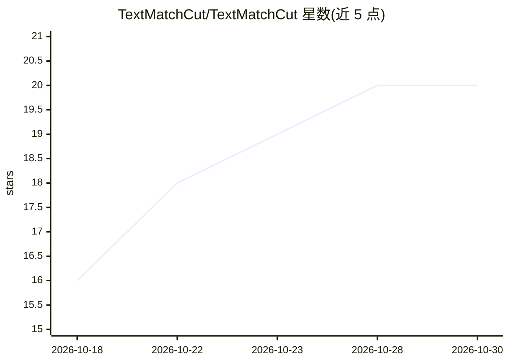

# TextMatchCut/TextMatchCut

⭐ 20 · TypeScript · GPL-3.0 · 推送 2025-12-06 · [GitHub](https://github.com/TextMatchCut/TextMatchCut) · [官网](https://textmatchcut.github.io/) · 组织维护

**生成分词对齐混剪视频的跨平台本地桌面应用**

基于 Wails、Go 与 React 构建的免费开源跨平台桌面（Web）应用，用于生成 TextMatchCut（文本匹配剪辑）作品，本地运行。要求用户自行安装 FFMPEG 并加入系统 PATH。Windows 提供 exe 可执行文件，macOS 提供兼容 Apple Silicon 与 Intel 的通用 dmg 镜像（未经 Apple 公证，首次运行需绕过 Gatekeeper），Linux 提供二进制并附依赖排查说明。另有在线网页版可用。

## 筛选速览

| 维度 | 判定 | 备注 |
|---|---|---|
| AI 角色 | `ai-native` | 本体是模型或模型工具 |
| 许可风险 | `viral` | GPL-3.0 |
| 部署形态 | `desktop` | 安装包/桌面程序 |
| 模型依赖 | — | README 未给出锁定关系 |
| 硬件要求 | — | 无带数字的原话,不猜 |
| 安装摩擦 | `medium` | 含编译或系统依赖之一 |
| 成熟度 | — | 结构信号不足 |

## 能力要点

- Wails + Go + React 构建的本地运行跨平台桌面应用
- macOS 通用二进制，兼容 Apple Silicon 与 Intel
- 提供在线网页版试用
- 使用 Minecraft 风格字体与报纸纹理素材

## 适用场景

- 制作文字与画面逐词对应的匹配剪辑视频
- 本地离线完成视频生成与导出（依赖 FFMPEG）
- 在浏览器中快速试用网页版效果

## 场景标签

`视频生成` · 领域:内容生成

## 证据(README 行号)

> L3:  A free, open-source, cross-platform desktop (webapp) to generate TextMatchCut. Built with Wails, Go, and React. Run

## 星数曲线

2026-10-18 16 → 2026-10-30 20（+4）

---
*卡片 v1 · prompt 1.4 · 生成 2026-10-28 · 置信度 mid · 依据 README sha `32e781978c54` · [字段定义](../../DATASET.md)*
