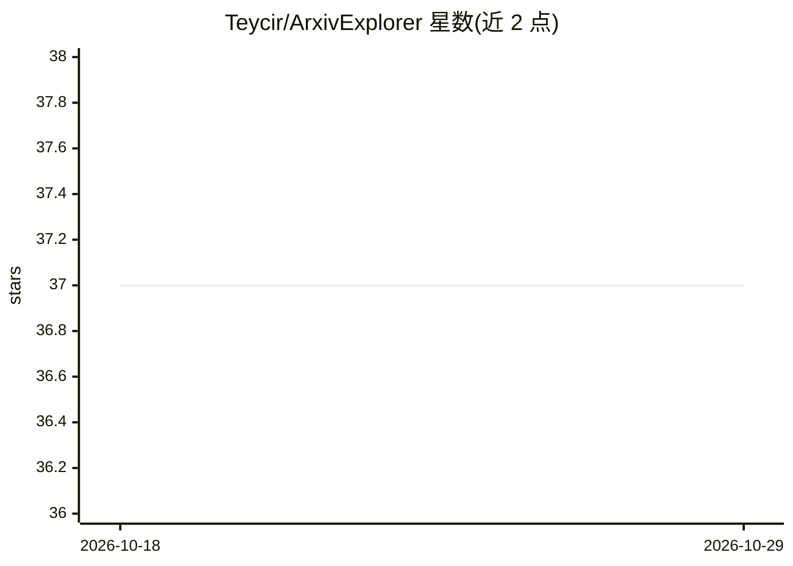

# Teycir/ArxivExplorer

⭐ 37 · TypeScript · NOASSERTION · 推送 2026-09-23 · [GitHub](https://github.com/Teycir/ArxivExplorer) · [官网](https://arxivexplorer.arxivexplorer.workers.dev/) · 个人维护

**arXiv 论文语义检索引擎：混合搜索与 AI 摘要，免登录**

部署在 Cloudflare Workers 边缘平台的 arXiv 论文搜索应用：结合 SQLite FTS5 关键词与 Vectorize 语义向量的混合检索，支持作者/引用数/分类/日期过滤；AI 部分由 Workers AI（Llama 3.1 + BGE 嵌入）生成结构化摘要（TL;DR、贡献、方法、局限）、实体抽取与声明支持/反驳分类，本地批量摄取可用 Ollama（gemma4 / nomic-embed-text）。数据管道每小时轮询 arXiv API，经 Semantic Scholar/CrossRef/OpenAlex/Papers With Code 富化，附引用追踪、论文对比、书签导出与 CLI。面向需要论文检索的研究者与开发者，自部署需 Node.js 18+、Wrangler CLI 与 Cloudflare 账户；Workers AI 免费层限制每日约 227 篇处理量。

## 筛选速览

| 维度 | 判定 | 备注 |
|---|---|---|
| AI 角色 | `ai-native` | 本体是模型或模型工具 |
| 许可风险 | `none` | NOASSERTION |
| 部署形态 | `library` | 以包/库形式分发 |
| 模型依赖 | local-ok | 支持本地模型 |
| 硬件要求 | — | 无带数字的原话,不猜 |
| 安装摩擦 | `low` | 无编译、无系统依赖或容器化 |
| 成熟度 | — | 结构信号不足 |

## 能力要点

- FTS5 关键词 + Vectorize 语义向量混合检索与高级过滤
- AI 生成结构化摘要、实体抽取与科学声明支持/反驳分类
- 本地 Ollama 批量摄取管道（gemma4:e4b + nomic-embed-text）
- Semantic Scholar / CrossRef / OpenAlex / Papers With Code 元数据富化

## 适用场景

- 语义检索 arXiv 论文并获取结构化 AI 摘要
- 按作者、引用数、分类筛选并对比多篇论文
- 追踪论文引用变化与版本更新
- 通过 arxiv-cli 供 AI 助手调用检索

## 场景标签

`语义搜索` `科研工具` · 领域:知识与检索

## 证据(README 行号)

> L25: **Fast semantic arXiv paper search with AI-powered summaries — no login required.**
> L72: - **Pre-Generated Summaries** — TL;DR, key contributions, methods, limitations, beginner/technical explanations
> L74: - **Claim Classification** — AI-powered support/contradiction analysis for scientific claims

## 星数曲线

2026-10-18 37 → 2026-10-29 37（+0）

---
*卡片 v1 · prompt 1.4 · 生成 2026-10-25 · 置信度 high · 依据 README sha `e0b9faade0ae` · [字段定义](../../DATASET.md)*
