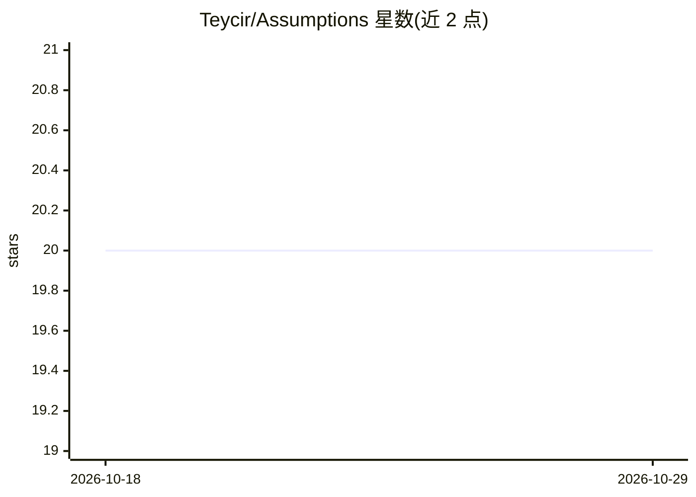

# Teycir/Assumptions

⭐ 20 · TypeScript · MIT · 推送 2026-07-27 · [GitHub](https://github.com/Teycir/Assumptions) · 个人维护

**将代码 diff 转为有证据支撑的隐藏假设账本的 agent 技能**

面向编码 agent 的 SKILL.md 技能文件：把 Git diff / PR 变更转成‘假设账本’，列出每条必须成立的条件、仓库内证据（文件/行定位）、失效后果、保护状态（Protected/Partially/Unprotected/Unknown）、证伪测试与 P0–P3 优先级。以单个 Markdown 文件交付，无构建步骤、无依赖、无需云端账号；Claude Code 为参考集成，其他支持技能/指令文件的 agent 也可通过粘贴或配置使用。限制：仅能核验仓库内可见证据，无法验证未文档化的生产行为。

## 筛选速览

| 维度 | 判定 | 备注 |
|---|---|---|
| AI 角色 | `ai-ecosystem` | LLM/agent 周边工具 |
| 许可风险 | `permissive` | MIT |
| 部署形态 | `None` |  |
| 模型依赖 | locked-api |  |
| 硬件要求 | — | 无带数字的原话,不猜 |
| 安装摩擦 | `low` | 无编译、无系统依赖或容器化 |
| 成熟度 | — | 结构信号不足 |

## 能力要点

- diff → 假设账本：每条含证据定位、失效后果与证伪测试
- P0–P3 优先级与保护状态、证据置信度双层标签
- 单文件 SKILL.md 交付，无构建、零依赖、离线可用
- 提供 --deploy/--security/--concurrency/--tests/--compact 等模式

## 适用场景

- 合并前扫描支付/迁移等高风险 diff 的隐藏假设
- 为认证端点生成跨租户越权的证伪测试
- 生成 PR 可用的 P0/P1 风险简表
- 把 review 发现的风险直接转成可写的回归测试

## 场景标签

`代码审查` · 领域:编码与开发

## 证据(README 行号)

> L37: Turn a diff into an evidence-backed **Assumption Ledger**: the conditions
> L166: No build step, no dependencies, no account. `SKILL.md` is the entire
> L187: **Any other agent:** clone or download this repository and point your

## 星数曲线

2026-10-18 20 → 2026-10-29 20（+0）

---
*卡片 v1 · prompt 1.4 · 生成 2026-10-28 · 置信度 high · 依据 README sha `0771843a18af` · [字段定义](../../DATASET.md)*
