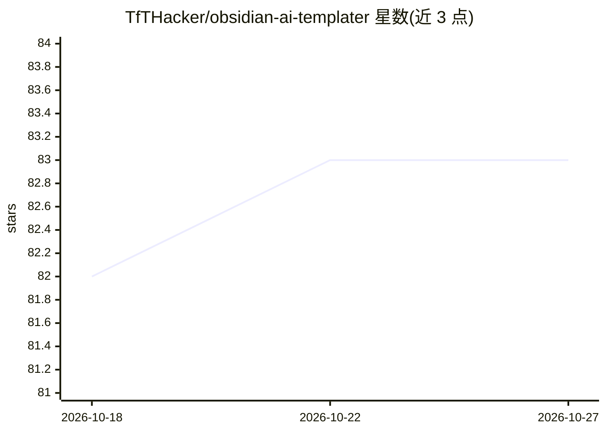

# TfTHacker/obsidian-ai-templater

⭐ 83 · TypeScript · MIT · 推送 2026-09-29 · [GitHub](https://github.com/TfTHacker/obsidian-ai-templater) · [官网](https://tfthacker.com/AIT) · 个人维护

**为 Obsidian Templater 模板添加 LLM 对话命令的插件**

Obsidian 插件，扩展 Templater 使模板内可调用大语言模型：通过 tp.ai.chat 等命令在模板执行时向 LLM 发送提问并插入回答。主要面向 OpenAI 的模型（如 ChatGPT 所用模型），也兼容任何支持 OpenAI API 的 LLM，可配置为本地 LLM。使用 OpenAI 服务需要 API key，未配置本地 LLM 时会向 OpenAI API 发起网络请求。详细用法见作者网站文档。

## 筛选速览

| 维度 | 判定 | 备注 |
|---|---|---|
| AI 角色 | `ai-native` | 本体是模型或模型工具 |
| 许可风险 | `permissive` | MIT |
| 部署形态 | `None` |  |
| 模型依赖 | — | README 未给出锁定关系 |
| 硬件要求 | — | 无带数字的原话,不猜 |
| 安装摩擦 | `low` | 无编译、无系统依赖或容器化 |
| 成熟度 | — | 结构信号不足 |

## 能力要点

- Templater 模板内直接调用 tp.ai.chat 获取 LLM 回答
- 主要适配 OpenAI LLM，兼容任何支持 OpenAI API 的模型
- 可配置为本地 LLM 以避免外部网络请求

## 适用场景

- 在 Obsidian 笔记模板中用自然语言生成内容
- Templater 用户在模板流程中嵌入 LLM 问答
- 配合本地 LLM 在笔记工作流中离线生成内容

## 场景标签

`AI 写作` · 领域:内容生成

## 证据(README 行号)

> L3: This plugin extends Templater to interact with large language models. It is primarily designed to work with OpenAI L
> L7: `<%tp.ai.chat("How far is the moon from the earth?")%>`

## 星数曲线

2026-10-18 82 → 2026-10-27 83（+1）

---
*卡片 v1 · prompt 1.4 · 生成 2026-10-24 · 置信度 high · 依据 README sha `2ac681ddaa14` · [字段定义](../../DATASET.md)*
