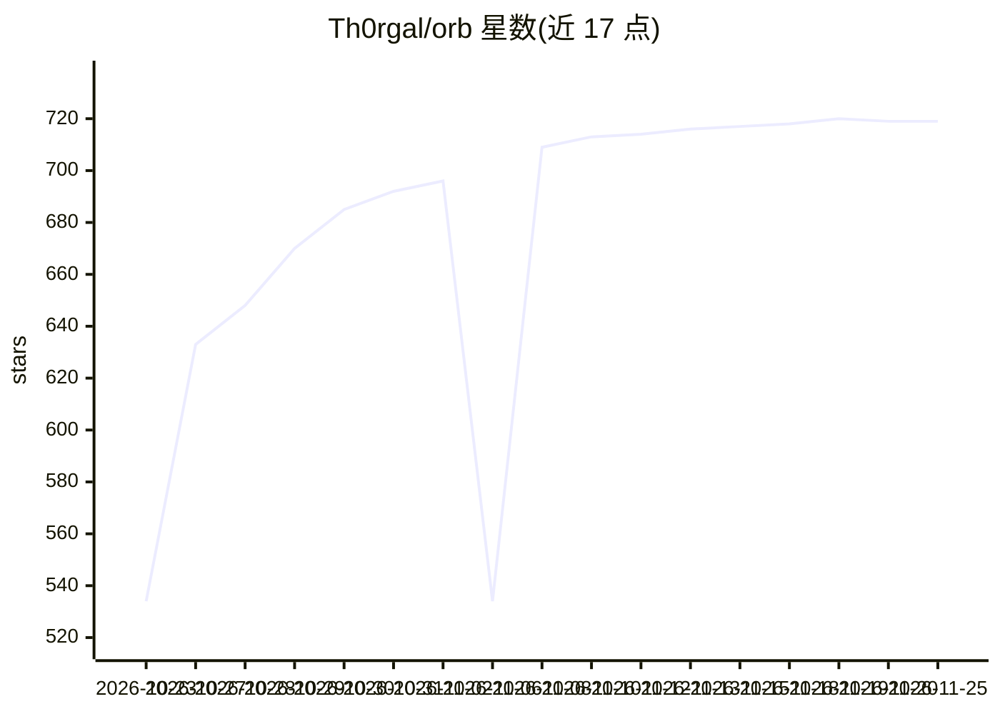

# Th0rgal/orb

⭐ 719 · Lean · 推送 2026-11-24 · [GitHub](https://github.com/Th0rgal/orb) · [官网](https://orb.thomas.md) · 个人维护

**在 macOS/iOS 统一连接与管理多个 AI agent 编排器与模型接入的客户端**

Orb 是一个客户端/控制平面应用，用于将订阅账号、API key 与本地/远程机器接入统一的 agent 工作台：支持在本机、自有服务器（经 Core 后端）或云 agent（Hermes、Grok Bot、Cursor Cloud）三种执行模式运行 Claude Code、Codex、Antigravity、OpenCode、Grok 等编排器，并提供会话续接、`/btw` 侧栏问答、任务唤醒与工作区跨机迁移。桌面端基于 SolidJS 与原生 WebKit 壳，后端 Core 用 Lean 4 实现并带形式化决策内核；经 Docker 或原生 Linux 方式部署。

## 筛选速览

| 维度 | 判定 | 备注 |
|---|---|---|
| AI 角色 | `ai-ecosystem` | LLM/agent 周边工具 |
| 许可风险 | `none` | — |
| 部署形态 | `None` |  |
| 模型依赖 | — | README 未给出锁定关系 |
| 硬件要求 | — | 无带数字的原话,不猜 |
| 安装摩擦 | `low` | 无编译、无系统依赖或容器化 |
| 成熟度 | — | 结构信号不足 |

## 能力要点

- 支持本机/私有云/云 agent 三种执行模式，统一管理 Claude Code、Codex、Antigravity、OpenCode、Grok 等编排器
- 订阅账号 OAuth 登录与 CLIProxyAPI Plus 代理的多账号路由轮换
- 桌面端不捆绑 Chromium/Node.js，附带 Lean 4 形式化决策内核
- iOS 客户端连接同一 Core，可浏览任务记录、发送追问并管理后端与提供商

## 适用场景

- 在多台本地/远程机器上集中运行和管理编码 agent 任务
- 把多个订阅账号通过代理做推理路由与额度轮换
- 在 iOS 上随时查看与续接 agent 会话

## 场景标签

`编码 Agent` · 领域:编码与开发

## 证据(README 行号)

> L5:  All your AI providers, machines, and agent harnesses in one place.
> L26: Use **Claude Code**, **Codex**, **Antigravity**, **OpenCode** or **Grok** for
> L91: **Orb is the client; Core is its backend.**

## 星数曲线

2026-10-23 534 → 2026-11-25 719（+185）

---
*卡片 v1 · prompt 1.4 · 生成 2026-11-25 · 置信度 high · 依据 README sha `224363752af8` · [字段定义](../../DATASET.md)*
