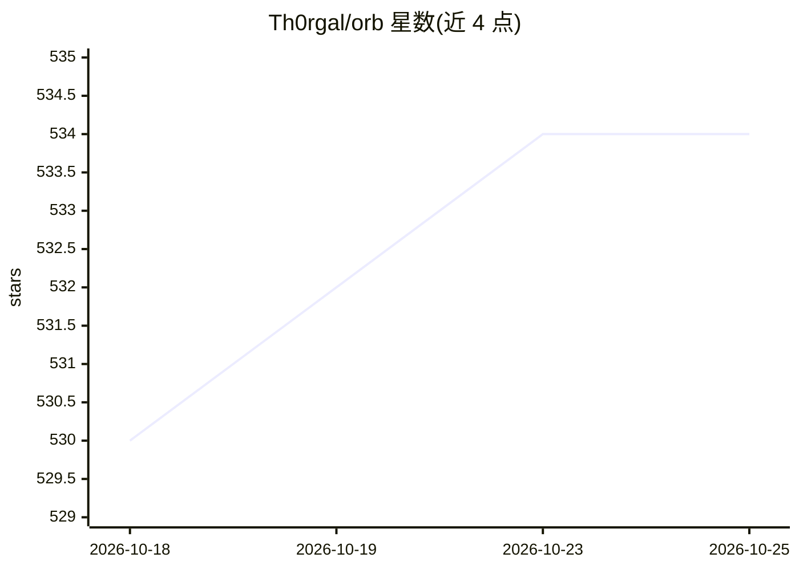

# Th0rgal/orb

⭐ 534 · Rust · 推送 2026-10-24 · [GitHub](https://github.com/Th0rgal/orb) · [官网](https://orb.thomas.md) · 个人维护

**统一管理 AI 订阅、机器与 agent 运行的 macOS/iOS 客户端**

Orb 是连接沙箱后端 sandboxed.sh 的桌面（Tauri+SolidJS）与 iOS（SwiftUI）客户端：把用户的 AI 订阅、API key 和本地硬件接入自有机器，统一编排 Claude Code、Codex、OpenCode、Grok 等编码 agent 框架。支持本机、私有云（宿主或隔离容器）与云端 agent 三种执行模式，提供跨设备接续对话、任务唤醒恢复、工作区迁移、订阅账号路由（CLIProxyAPI）与 MCP 控制面；后端含 Lean 4 形式化验证的编排内核。需先自行运行后端（Docker 或原生 Linux），客户端需从源码构建。

## 筛选速览

| 维度 | 判定 | 备注 |
|---|---|---|
| AI 角色 | `ai-ecosystem` | LLM/agent 周边工具 |
| 许可风险 | `none` | — |
| 部署形态 | `None` |  |
| 模型依赖 | — | README 未给出锁定关系 |
| 硬件要求 | — | 无带数字的原话,不猜 |
| 安装摩擦 | `low` | 无编译、无系统依赖或容器化 |
| 成熟度 | — | 结构信号不足 |

## 能力要点

- 本机/私有云/云端 agent 三种执行模式统一编排
- 支持 Claude Code、Codex、Antigravity、OpenCode、Grok 等框架
- 订阅账号 OAuth 接入与代理路由轮换（CLIProxyAPI）
- Lean 4 形式化验证的编排内核与 MCP 控制面

## 适用场景

- 在多个自有机器与云 agent 间统一运行编码任务
- 跨 macOS 与 iOS 接续查看 agent 会话与结果
- 把已有 ChatGPT/Cursor 等订阅接入本地 agent 工作流

## 场景标签

`编码 Agent` · 领域:编码与开发

## 证据(README 行号)

> L6:  Connect your subscriptions, API keys, and local hardware to your machines, and orchestrate every agent harness from
> L92: **Orb is the client; sandboxed.sh (the project's former name) is now the backend to the Orb clients.**

## 星数曲线

2026-10-18 530 → 2026-10-25 534（+4）

---
*卡片 v1 · prompt 1.4 · 生成 2026-10-22 · 置信度 high · 依据 README sha `703a2661b385` · [字段定义](../../DATASET.md)*
