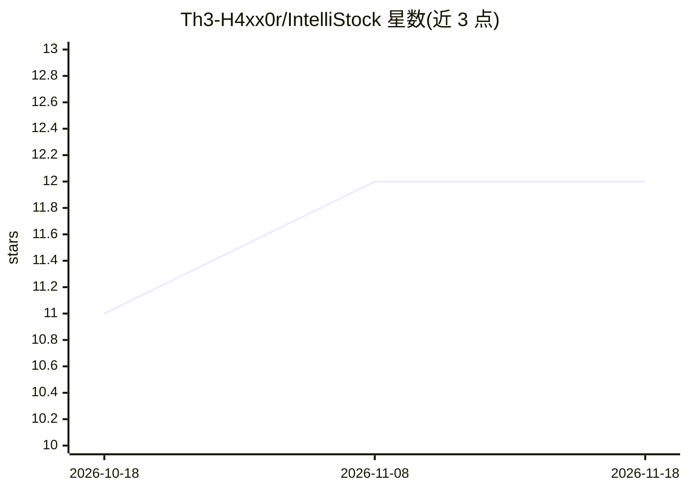

# Th3-H4xx0r/IntelliStock

⭐ 12 · Python · MIT · 推送 2026-11-15 · [GitHub](https://github.com/Th3-H4xx0r/IntelliStock) · 个人维护

**自托管算法交易平台：个人在自己的机器上构建并运行交易策略**

单用户自托管交易工作台，运行在自己的基础设施与券商账户上：内置 18 个声明式策略模块，提供回测引擎（含逐笔回放）、多实例容器化 bot 管理、实时交易终端与仓位监控。AI 部分包括可创建/管理交易实例的 agent（含排行榜）、内置 40+ 工具的聊天助手（破坏性操作需 UI 确认）、FinBERT 新闻情绪推理，以及基于 Neo4j 的 11 阶段 Graph Nexus 关系图构建。仅用于教育与研究用途，README 反复强调回测结果非预测、务必先跑 paper mode。

## 筛选速览

| 维度 | 判定 | 备注 |
|---|---|---|
| AI 角色 | `ai-enhanced` | 去掉 AI 部分产品仍成立 |
| 许可风险 | `permissive` | MIT |
| 部署形态 | `self-host` | docker 或自建部署 |
| 模型依赖 | — | README 未给出锁定关系 |
| 硬件要求 | `cpu-ok` | |
| 安装摩擦 | `low` | 无编译、无系统依赖或容器化 |
| 成熟度 | — | 结构信号不足 |

## 能力要点

- 18 个声明式策略模块，复用于回测与实盘实例
- 回测历史含权益曲线、回撤图与 0.5×–10× 逐笔回放
- 40+ 工具的 LLM 聊天助手，破坏性工具需 UI 显式确认
- Graph Nexus：基于 Neo4j 的 11 阶段股权关系图

## 适用场景

- 在自己服务器上用 Alpaca paper 账户跑策略回测与模拟交易
- 通过聊天助手用自然语言查询组合并审批下单操作
- 构建 SEC 文件与机构持仓的关系图谱辅助分析

## 场景标签

`金融量化` · 领域:学习与行业

## 证据(README 行号)

> L49: **IntelliStock** is a _self-hosted algorithmic trading platform_ you run on your
> L287: strategy is opt-in per instance — every other strategy (RSI, MACD,
> L288: ML News, Volatility, Earnings, the risk guards) runs without ever

## 星数曲线

2026-10-18 11 → 2026-11-18 12（+1）

---
*卡片 v1 · prompt 1.4 · 生成 2026-11-18 · 置信度 high · 依据 README sha `5a670710cdad` · [字段定义](../../DATASET.md)*
