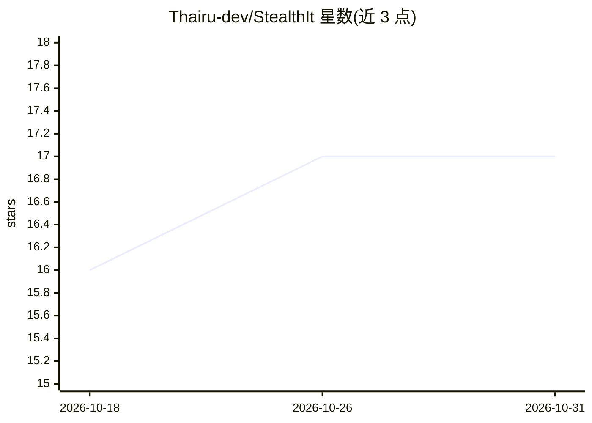

# Thairu-dev/StealthIt

⭐ 17 · Python · MIT · 推送 2026-08-19 · [GitHub](https://github.com/Thairu-dev/StealthIt) · [官网](https://stealthit-web.vercel.app/) · 个人维护

**悬浮式隐形 AI 桌面助手：实时会议转录与屏幕分析，屏幕共享中不可见**

基于 Python/PySide6 的桌面 AI 助手，自称为 Cluely 的免费替代：悬浮窗口在任务栏与屏幕录制/视频会议（Zoom/Teams/Meet/Discord/OBS）中不可见。功能包括本地 Whisper 语音与会议转录并生成纪要、Ctrl+Enter 截图 OCR 多模态分析（用于编码题解析、文档研读）、全局热键与本地加密存储 API 密钥。多提供商支持 Gemini、OpenAI、Anthropic、OpenRouter 及本地 Ollama。仓库同时举办 AI 模型构建竞赛，含两个实现目录；安装需 clone 源码并 pip 安装依赖，计划中的独立安装包尚未发布。

## 筛选速览

| 维度 | 判定 | 备注 |
|---|---|---|
| AI 角色 | `ai-native` | 本体是模型或模型工具 |
| 许可风险 | `permissive` | MIT |
| 部署形态 | `desktop` | 安装包/桌面程序 |
| 模型依赖 | local-ok | 支持本地模型 |
| 硬件要求 | — | 无带数字的原话,不猜 |
| 安装摩擦 | `low` | 无编译、无系统依赖或容器化 |
| 成熟度 | — | 结构信号不足 |

## 能力要点

- 本地 Whisper 语音/会议转录并生成结构化纪要
- 内存截图 OCR 多模态分析（不落盘临时文件）
- 窗口对任务栏与屏幕录制/共享不可见
- 多提供商：Gemini/OpenAI/Anthropic/OpenRouter/本地 Ollama，密钥本地加密存储

## 适用场景

- 会议中实时转录并生成摘要与行动项
- 技术面试/刷题时截图题目获取算法分析
- 演讲/网研会时悬浮提示词且观众不可见
- 不想让屏幕共享对象看到助手窗口的场景

## 场景标签

`AI 助手` `语音识别` `OCR` · 领域:对话与助手

## 证据(README 行号)

> L8: **StealthIt** is a free, open-source **Cluely alternative** and invisible AI desktop assistant designed for **live m
> L20: |**🎙️ Live Meeting Assistant & AI Summarizer**|Silently transcribes Zoom, Teams, Google Meet, or in-person audio lo
> L41: * **🧠 Multi-Provider AI**: Native support for **Google Gemini**, **OpenAI**, **Anthropic Claude**, **OpenRouter/Age

## 星数曲线

2026-10-18 16 → 2026-10-31 17（+1）

---
*卡片 v1 · prompt 1.4 · 生成 2026-10-29 · 置信度 mid · 依据 README sha `8988421ff439` · [字段定义](../../DATASET.md)*
