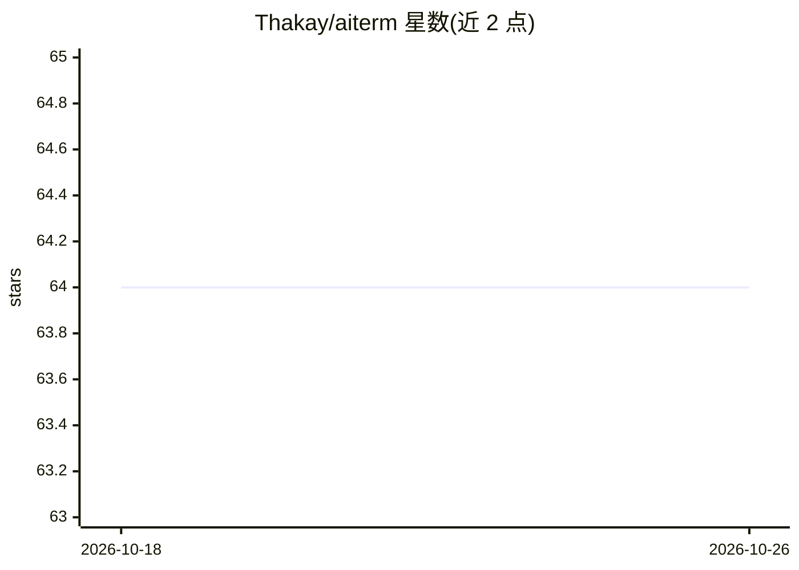

# Thakay/aiterm

⭐ 64 · Go · MIT · 推送 2026-10-18 · [GitHub](https://github.com/Thakay/aiterm) · 个人维护

**把自然语言转成终端 shell 命令并按确认执行的 Go CLI**

面向开发者的终端工具：输入英文描述，由 LLM 生成适配当前操作系统（macOS BSD/Linux GNU 工具）的单条 Unix 命令，用户可运行、复制、编辑或继续追问。默认调用 OpenAI API，可通过 -url 指向任意 OpenAI 兼容端点（含 Ollama、LM Studio、OpenRouter 的本地或第三方模型）。安全机制包括：命令须按 y 确认才执行、拒绝含控制或不可见字符的回复、多行命令提示。以 Go 单一静态二进制分发，支持 Linux/macOS amd64/arm64。

## 筛选速览

| 维度 | 判定 | 备注 |
|---|---|---|
| AI 角色 | `ai-native` | 本体是模型或模型工具 |
| 许可风险 | `permissive` | MIT |
| 部署形态 | `library` | 以包/库形式分发 |
| 模型依赖 | local-ok | 支持本地模型 |
| 硬件要求 | — | 无带数字的原话,不猜 |
| 安装摩擦 | `low` | 无编译、无系统依赖或容器化 |
| 成熟度 | — | 结构信号不足 |

## 能力要点

- 自然语言生成适配 OS 的单条 shell 命令
- 支持任意 OpenAI 兼容端点，含 Ollama/LM Studio 本地模型
- 运行前确认制；拒绝隐藏字符回复、标记多行命令
- 单一静态二进制（Linux/macOS amd64/arm64），含 -print 脚本模式与 shell 补全

## 适用场景

- 忘记 find/tar 等命令语法时用自然语言获取命令
- 在终端里让 AI 生成命令并确认后执行、复制或编辑
- 接入本地 Ollama 模型离线生成命令
- 脚本或键绑定中用 -print 模式输出命令

## 场景标签

`代码生成` · 领域:编码与开发

## 证据(README 行号)

> L9: `aiterm` translates natural language into shell commands, right in your terminal.
> L14: It is written in Go, ships as a single binary, and works with OpenAI or any
> L110: |`-model`|`AITERM_MODEL`|`gpt-4.1-mini`|Model used to generate commands|

## 星数曲线

2026-10-18 64 → 2026-10-26 64（+0）

---
*卡片 v1 · prompt 1.4 · 生成 2026-10-24 · 置信度 high · 依据 README sha `96573f93a549` · [字段定义](../../DATASET.md)*
