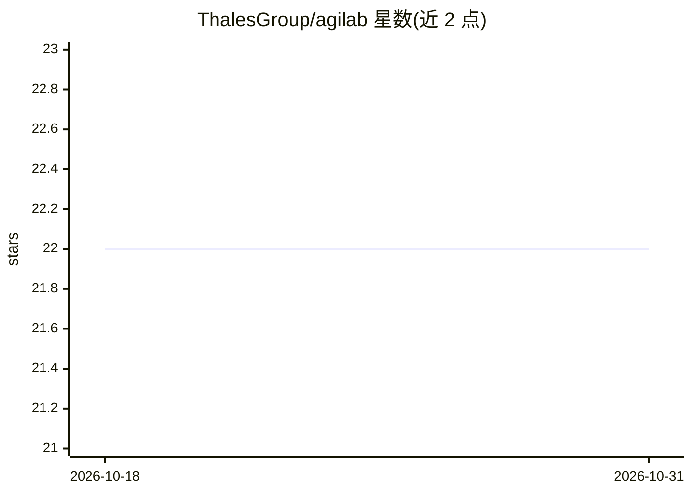

# ThalesGroup/agilab

⭐ 22 · Python · NOASSERTION · 推送 2026-10-30 · [GitHub](https://github.com/ThalesGroup/agilab) · [官网](https://thalesgroup.github.io/agilab) · 组织维护

**面向 AI/ML 工程的可复现工作台：笔记本转可执行应用**

由 Thales 维护的开源 AI/ML 工程平台，把 notebook 和脚本转换为可执行、可移植、带运行证据的应用。机制包括：本地 agent（Tokki 协调）读取笔记本并生成应用、构建前依赖与输入预检、在独立进程中重放持久化 workflow 并要求 JSON 结果一致、保存 run_manifest.json 证据与可恢复的构建检查点；提供稳定 agi-core 导出运行时、可选 MLflow 跟踪、本地或分布式执行，以及 MCP 入口（agilab-mcp）与 agent 运行校验。限制：验证证明结果一致性而非科学正确性，仍需人工审查。

## 筛选速览

| 维度 | 判定 | 备注 |
|---|---|---|
| AI 角色 | `ai-ecosystem` | LLM/agent 周边工具 |
| 许可风险 | `none` | NOASSERTION |
| 部署形态 | `library` | 以包/库形式分发 |
| 模型依赖 | — | README 未给出锁定关系 |
| 硬件要求 | — | 无带数字的原话,不猜 |
| 安装摩擦 | `low` | 无编译、无系统依赖或容器化 |
| 成熟度 | — | 结构信号不足 |

## 能力要点

- 笔记本自动转换为带验证的应用（执行/新结果/启动/交互四类检查）
- 构建前 --check 预检依赖与输入，避免消耗 provider 调用
- 持久化 workflow 在独立进程重放并要求结果一致，不符即失败
- 稳定 agi-core 导出运行时与 MCP agent 入口及运行校验

## 适用场景

- 把探索性 ML 笔记本转成可复现、可移植的应用
- 在进入重量级跟踪/集群平台前先让 ML 工作可重放
- 通过 MCP 客户端让 agent 在安全边界内使用 AGILAB 工具

## 场景标签

`MLOps` `科研工具` · 领域:学习与行业

## 证据(README 行号)

> L3: AGILAB is an anti-lock-in reproducibility workbench for AI/ML engineering.
> L4: It turns notebooks and scripts into executable, portable, evidence-backed apps
> L5: with a stable `agi-core` handoff, optional MLflow tracking, and local or
> L213: That is the center of gravity: make exploratory ML work replayable before

## 星数曲线

2026-10-18 22 → 2026-10-31 22（+0）

---
*卡片 v1 · prompt 1.4 · 生成 2026-10-27 · 置信度 mid · 依据 README sha `8883f78847ec` · [字段定义](../../DATASET.md)*
