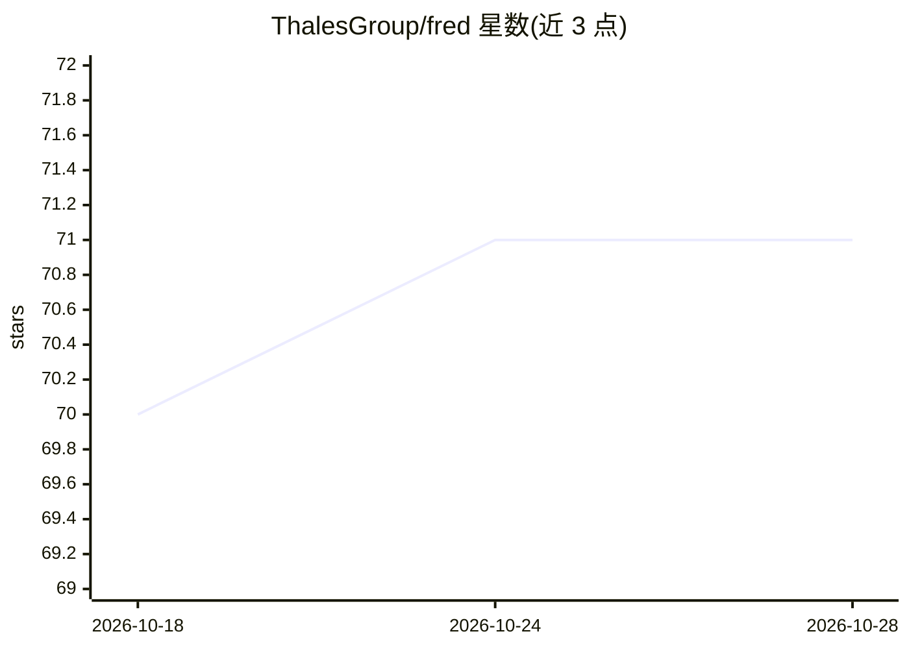

# ThalesGroup/fred

⭐ 71 · Python · Apache-2.0 · 推送 2026-10-27 · [GitHub](https://github.com/ThalesGroup/fred) · [官网](https://fredk8.dev) · 组织维护

**面向团队与受监管场景的自托管 AI agent 平台（Thales 开源）**

Apache 2.0 平台，供团队在自有文档与内网环境中构建、部署与运营 AI agent 应用。由三个平台应用（控制平面后端、知识流后端含摄取/向量化/检索、React 聊天前端）与可发布的 SDK 栈（fred-sdk / fred-runtime / fred-core）组成；agent 以独立 Pod 形式注册到控制平面，无需改核心。内置身份、权限、审计与评估，支持从笔记本到离线集群部署。默认本地用 SQLite + ChromaDB，模型接入支持 OpenAI API、私有 Ollama 与 Azure AI 端点。提供 Dev Container 与原生（仅 Unix）两种启动方式，原生模式需 Pandoc、LibreOffice、libmagic 等系统依赖。

## 筛选速览

| 维度 | 判定 | 备注 |
|---|---|---|
| AI 角色 | `ai-ecosystem` | LLM/agent 周边工具 |
| 许可风险 | `permissive` | Apache-2.0 |
| 部署形态 | `library` | 以包/库形式分发 |
| 模型依赖 | local-ok | 支持本地模型 |
| 硬件要求 | — | 无带数字的原话,不猜 |
| 安装摩擦 | `low` | 无编译、无系统依赖或容器化 |
| 成熟度 | — | 结构信号不足 |

## 能力要点

- 控制平面/知识流/前端三平台应用 + 可独立部署的 agent Pod 架构
- 文档摄取、向量化与检索（默认 pypdf/Docling/pypdfium2 管线）
- 默认本地存储 SQLite + ChromaDB，认证默认 mock，无需外部组件（LLM API 除外）
- 模型接入支持 OpenAI / 私有 Ollama / Azure AI 端点，经 models_catalog.yaml 配置

## 适用场景

- 在数据不能出内网的环境里为团队部署带权限与审计的 AI agent 工作台
- 基于 fred-sdk 开发并注册自有 agent Pod，与平台协同运行
- 在自有文档语料上做带身份与访问控制的团队问答

## 场景标签

`Agent 框架` `文档问答` · 领域:Agent 开发

## 证据(README 行号)

> L10: Fred is an open-source platform for putting a **team** to work with AI agents on
> L36: - **A hosted platform** — control plane, knowledge flow, chat frontend, auth, team access control, observability, a
> L43: |Platform|`apps/control-plane-backend`|Teams, sessions, agent enrollment, product APIs, `ExecutionGrant` issuance|

## 星数曲线

2026-10-18 70 → 2026-10-28 71（+1）

---
*卡片 v1 · prompt 1.4 · 生成 2026-10-24 · 置信度 mid · 依据 README sha `2974996de5c6` · [字段定义](../../DATASET.md)*
