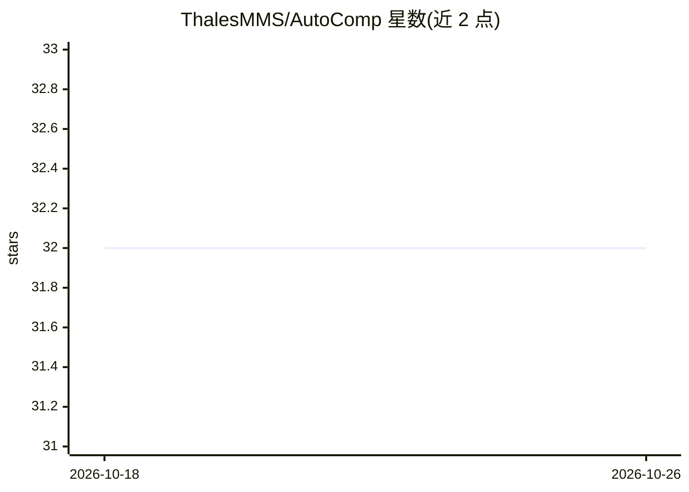

# ThalesMMS/AutoComp

⭐ 32 · Swift · Apache-2.0 · 推送 2026-08-18 · [GitHub](https://github.com/ThalesMMS/AutoComp) · 组织维护

**macOS 菜单栏 AI 自动补全应用：监听文本框并给出补全建议**

面向 Apple Silicon Mac（macOS 14+）的菜单栏应用：通过辅助功能监听当前聚焦的文本框，向已配置的补全后端请求短补全，以内联覆盖层或镜像窗口展示，Tab 接受下一词、反引号接受整句。后端支持远程 OpenAI 兼容端点、Apple Intelligence（FoundationModels 可用时）、以及可选的本地 llama.cpp 运行时（需 GGUF 模型，默认构建不链接）。隐私控制包括默认关闭的收集、Keychain 加密的本地个性化存储与一键删除。安装运行通过构建脚本完成，发布流程含 DMG 打包与公证。

## 筛选速览

| 维度 | 判定 | 备注 |
|---|---|---|
| AI 角色 | `ai-native` | 本体是模型或模型工具 |
| 许可风险 | `permissive` | Apache-2.0 |
| 部署形态 | `desktop` | 安装包/桌面程序 |
| 模型依赖 | local-ok | 支持本地模型 |
| 硬件要求 | — | 无带数字的原话,不猜 |
| 安装摩擦 | `low` | 无编译、无系统依赖或容器化 |
| 成熟度 | `idea` | |

## 能力要点

- 监听系统可访问文本框，内联/镜像窗口两种建议展示模式
- 三种后端：远程 OpenAI 兼容端点、Apple Intelligence、可选本地 llama.cpp + GGUF
- 隐私控制：收集默认关闭、来源级限制、Keychain 管理密钥的加密本地存储与全量删除
- 浏览器/写作应用/终端/代码编辑器兼容性目录与 Google Docs 检测

## 适用场景

- 在任意 macOS 应用中获得 AI 文本补全
- 使用本地 llama.cpp 模型实现不上传数据的补全
- 配置远程 OpenAI 兼容端点作为统一补全服务

## 场景标签

`AI 写作` · 领域:内容生成

## 证据(README 行号)

> L3: AutoComp is a macOS 14+ menu bar autocomplete app for Apple Silicon Macs. It watches the active accessible text fiel
> L22: - Remote OpenAI-compatible completion backend configurable from Settings > Model.
> L24: - Local in-process llama.cpp runtime support when an app build links the optional runtime and a GGUF model file is 

## 星数曲线

2026-10-18 32 → 2026-10-26 32（+0）

---
*卡片 v1 · prompt 1.4 · 生成 2026-10-26 · 置信度 high · 依据 README sha `d95976ca8715` · [字段定义](../../DATASET.md)*
