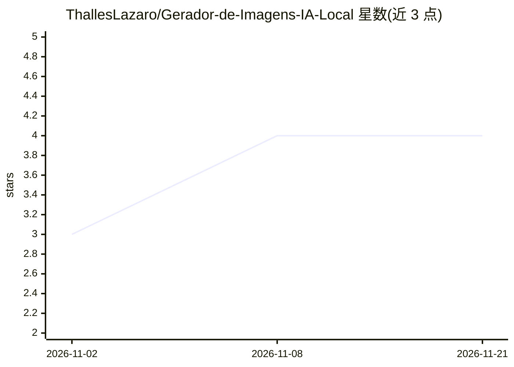

# ThallesLazaro/Gerador-de-Imagens-IA-Local

⭐ 4 · JavaScript · 推送 2026-10-24 · [GitHub](https://github.com/ThallesLazaro/Gerador-de-Imagens-IA-Local) · [官网](https://tutoriaisse.com/arquivos/gerador-de-imagens-ia-local) · 个人维护

**Windows 本地 AI 图像与视频生成器，含编辑/合成**

面向 Windows 用户的本地生成式媒体工具：通过 bat 脚本简化安装核心，按需从界面下载模型，避免手动配置 Python 环境与后端。支持文本生图（Qwen Image 2.1 Turbo）、参考图编辑、多图合成、Text-to-Video/Image-to-Video 及基于 FFmpeg 的轻量视频，附带本地画廊、生成队列、可复用 seed、显存不足时自动降分辨率重试（75%/50%）。模型目录 modelos.json 可编辑，支持自定义 URL 与 Q4_K/Q5_K/Q6_K/Q8_0 量化档位，聊天功能为可选辅助。

## 筛选速览

| 维度 | 判定 | 备注 |
|---|---|---|
| AI 角色 | `ai-native` | 本体是模型或模型工具 |
| 许可风险 | `none` | — |
| 部署形态 | `desktop` | 安装包/桌面程序 |
| 模型依赖 | local-ok | 支持本地模型 |
| 硬件要求 | — | 无带数字的原话,不猜 |
| 安装摩擦 | `medium` | 含编译或系统依赖之一 |
| 成熟度 | — | 结构信号不足 |

## 能力要点

- 本地 Text-to-Image/编辑/多图合并与 Text-to-Video/Image-to-Video
- 模型按需安装，接口内切换，modelos.json 目录免改代码
- 显存不足自动按 75%/50% 分辨率重试
- 画廊、队列、seed 复用与基于后端事件的进度/ETA

## 适用场景

- 在本地电脑无审查生成和编辑图像
- 用参考图做图像合成或图生视频
- 低显存机器上通过自动降分辨率完成生成

## 场景标签

`图像生成` `视频生成` · 领域:内容生成

## 证据(README 行号)

> L5: **Gerador de imagens com IA local sem censura para Windows**, com criação, edição, combinação de imagens, geração de
> L32: - **Text-to-Image local** com Qwen Image 2.1 Turbo.
> L36: - **Text-to-Video e Image-to-Video** com motor de vídeo IA compatível.

## 星数曲线

2026-11-02 3 → 2026-11-21 4（+1）

---
*卡片 v1 · prompt 1.4 · 生成 2026-11-21 · 置信度 high · 依据 README sha `d017e1eedf86` · [字段定义](../../DATASET.md)*
