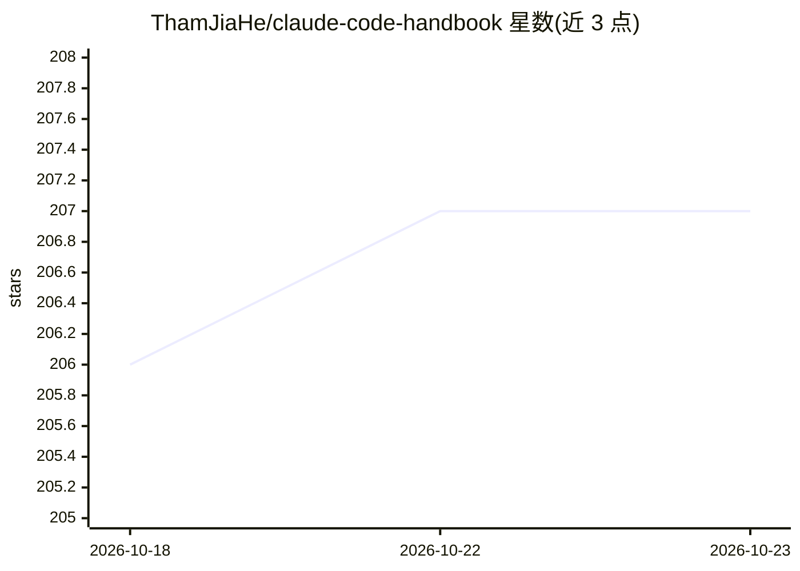

# ThamJiaHe/claude-code-handbook

⭐ 207 · Python · MIT · 推送 2026-04-19 · [GitHub](https://github.com/ThamJiaHe/claude-code-handbook) · 个人维护 · 中文 README

**Claude 提示工程与 Claude Code 使用指南合集（含100+技能目录）**

面向 Claude 与 Claude Code 用户的提示工程知识库：收录 Claude Code 深度指南（Hooks、Agent Teams、Subagents、插件、技能目录）、提示工程指南（10 组件框架、Ultrathink）、MCP 集成与研究分析等文档，含 31 个示例技能与模板。由每周运行的 AI 研究代理（Perplexity+Claude Opus）自动更新并人工合并。另介绍配套 Web 应用 ClaudeForge（7 家 AI 提供商的提示生成器，需单独克隆部署）与 claude-kopitiam 配置层，均为独立仓库，非本仓库本体。本仓库本身为文档，无需安装。

## 筛选速览

| 维度 | 判定 | 备注 |
|---|---|---|
| AI 角色 | `ai-knowledge` | 知识聚合/清单类 |
| 许可风险 | `permissive` | MIT |
| 部署形态 | `library` | 以包/库形式分发 |
| 模型依赖 | — | README 未给出锁定关系 |
| 硬件要求 | — | 无带数字的原话,不猜 |
| 安装摩擦 | `low` | 无编译、无系统依赖或容器化 |
| 成熟度 | — | 结构信号不足 |

## 能力要点

- 覆盖 Hooks、Agent Teams、Subagents、插件等 Claude Code 主题的指南合集
- 100+ 技能目录（15 类）与 31 个可直接使用的示例技能
- 每周由 AI 代理（Perplexity+Claude Opus）自动研究更新、人工审查合并
- 13 个社区仓库的深度研究分析

## 适用场景

- 系统学习 Claude 提示工程与 Claude Code 的进阶用法
- 查找现成的技能（Skills）与提示模板用于开发、测试、安全审计
- 了解 Claude Code 插件、Subagent 与多智能体生态

## 场景标签

`提示工程` `教程课程` · 领域:Agent 开发

## 证据(README 行号)

> L77: > The definitive guide to Claude prompt engineering and Claude Code mastery for Opus 4.6, Sonnet 4.6, and Haiku 4.5
> L129: |Skills Catalog|**100+ curated skills** across 15 categories|
> L157: |Research Report (Jan 2026)|8,500+ word institutional-grade analysis|

## 星数曲线

2026-10-18 206 → 2026-10-23 207（+1）

---
*卡片 v1 · prompt 1.4 · 生成 2026-10-22 · 置信度 mid · 依据 README sha `267e6487c4ae` · [字段定义](../../DATASET.md)*
