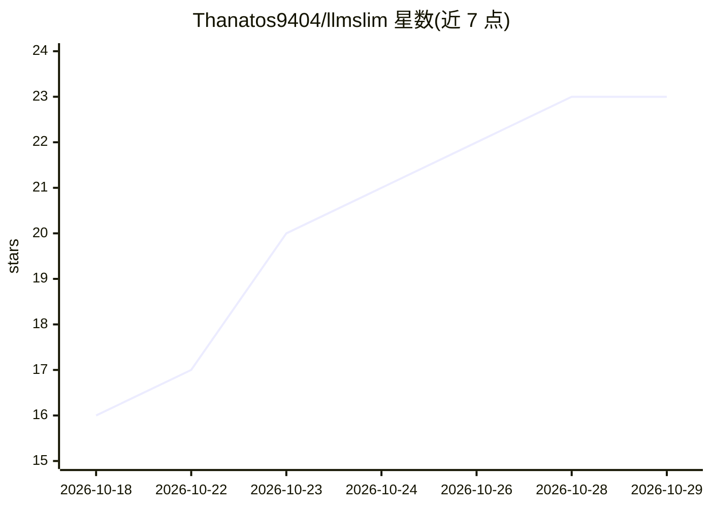

# Thanatos9404/llmslim

⭐ 23 · Python · MIT · 推送 2026-10-27 · [GitHub](https://github.com/Thanatos9404/llmslim) · [官网](https://www.llmslim.app) · 个人维护

**给 AI agent 的长期记忆与上下文压缩层：无 LLM 调用**

面向 AI agent 与编码工具的长期记忆和上下文选层：把用户与 agent 的消息逐字存入 SQLite/Postgres，按 token 预算检索相关片段；默认纯代码实现，不做 LLM 调用、无需 API key，结果确定性可复现。以 MCP 服务器、Python 库、小型 HTTP 服务器与 npm/TypeScript 客户端形式提供，内置 Claude Code 插件，并支持 Codex、Copilot CLI、Gemini CLI 等客户端接入。Core 还提供提示词/对话历史/检索文档/工具 schema 的压缩与上下文规划（Adaptive Context Planner），Sarvam、Zoho、MongoDB 集成放在可选 extras。另有私有 beta 的 LLMSlim Platform（专有许可，代码不在本仓库）。限制：默认词法匹配不识别改述，可加 cross-encoder 语义模式。

## 筛选速览

| 维度 | 判定 | 备注 |
|---|---|---|
| AI 角色 | `ai-ecosystem` | LLM/agent 周边工具 |
| 许可风险 | `permissive` | MIT |
| 部署形态 | `self-host` | docker 或自建部署 |
| 模型依赖 | locked-api |  |
| 硬件要求 | — | 无带数字的原话,不猜 |
| 安装摩擦 | `low` | 无编译、无系统依赖或容器化 |
| 成熟度 | `idea` | |

## 能力要点

- 逐字存储 + 预算内检索的长期记忆，默认路径无 LLM 调用、无 API key、确定性输出
- 五种 MCP 工具（remember/recall/list_memories/forget/fit_context），支持 Claude Code、Codex、Copilot CLI、Gemini CLI、Hermes 等客户端
- 提示词/RAG/工具 schema 压缩与 Adaptive Context Planner（可解释逐项决策、token 与成本遥测）
- Python 3.9+（MCP 服务器需 3.10+）、Node 18+，本地 SQLite 默认，Postgres/MongoDB 可选

## 适用场景

- 给我的 coding agent 加跨会话长期记忆，控制注入 prompt 的 token 预算
- 把长对话日志或工单压缩到指定 token 数以降低成本与延迟
- 为 LangChain / Pydantic AI agent 接入本地优先的记忆与上下文规划

## 场景标签

`Agent 记忆` · 领域:Agent 开发

## 证据(README 行号)

> L3: **Long-term memory and context selection for AI agents and coding tools, with no LLM call.**
> L6: token budget you set. It runs as an MCP server, a Python library or a small HTTP server.
> L73: - **Five MCP tools:** `remember`, `recall`, `list_memories`, `forget` and `fit_context`.

## 星数曲线

2026-10-18 16 → 2026-10-29 23（+7）

---
*卡片 v1 · prompt 1.4 · 生成 2026-10-28 · 置信度 mid · 依据 README sha `c80d71cebf4a` · [字段定义](../../DATASET.md)*
