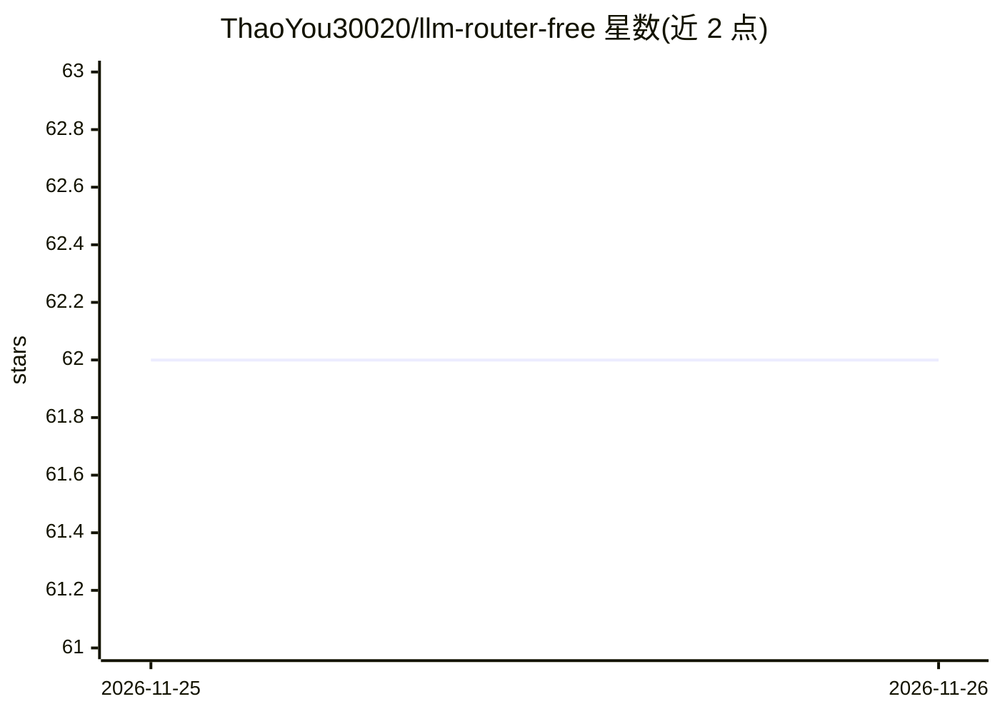

# ThaoYou30020/llm-router-free

⭐ 62 · C++ · MIT · 推送 2026-11-24 · [GitHub](https://github.com/ThaoYou30020/llm-router-free) · [官网](https://github.com/ThaoYou30020/llm-router-free/releases) · 个人维护

**面向开发者的免费档 LLM 路由器：单一密钥接入 15+ 供应商并自动降级**

面向 64 位 Windows 10/11 的低开销运行时与配置套件，通过统一的 API key 接入 15+ 免费 LLM 供应商，并在供应商不可用时自动 fallback。所有参数集中在 config/settings.json，支持热重载与免重启生效；提供免编译的预构建 x64 便携包（解压后运行安装器），也可用 CMake 从源码构建。压缩包需访问码解压，遥测默认静默。

## 筛选速览

| 维度 | 判定 | 备注 |
|---|---|---|
| AI 角色 | `ai-ecosystem` | LLM/agent 周边工具 |
| 许可风险 | `permissive` | MIT |
| 部署形态 | `desktop` | 安装包/桌面程序 |
| 模型依赖 | — | README 未给出锁定关系 |
| 硬件要求 | — | 无带数字的原话,不猜 |
| 安装摩擦 | `medium` | 含编译或系统依赖之一 |
| 成熟度 | — | 结构信号不足 |

## 能力要点

- 单一 API key 接入 15+ 免费供应商，自动 fallback
- JSON 配置热重载，免重启生效
- 预构建 x64 便携包，无需编译器即可运行
- 环形缓冲流水线、崩溃安全回滚等引擎组件说明

## 适用场景

- 在本地统一管理多个免费 LLM API 通道
- 供应商限流或故障时自动切换到备用通道
- 用单一 JSON 配置管理路由参数并热更新

## 场景标签

`模型网关` · 领域:Agent 开发

## 证据(README 行号)

> L5:  LlmRouterFree — Free-Tier LLM Router with Automatic Fallback (Portable x64 Build, JSON Configuration): One API key,
> L20: **LlmRouterFree — One API key, 15+ free providers, automatic fallback** (`llm-router-free`) is a dedicated, low-ove

## 星数曲线

2026-11-25 62 → 2026-11-26 62（+0）

---
*卡片 v1 · prompt 1.4 · 生成 2026-11-24 · 置信度 mid · 依据 README sha `f51604969117` · [字段定义](../../DATASET.md)*
