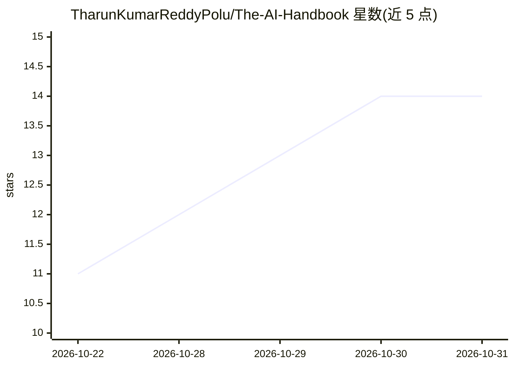

# TharunKumarReddyPolu/The-AI-Handbook

⭐ 14 · MIT · 推送 2026-10-19 · [GitHub](https://github.com/TharunKumarReddyPolu/The-AI-Handbook) · 个人维护

**AI 工具与学习资源策展手册：320+ 工具按 18 类组织**

由个人维护的策展型 AI 知识库：收录 320+ 个 AI 工具，覆盖 AI 编码、Agent 框架、本地推理、MCP 生态、创意生成等 18 个类别，以独立主题指南形式呈现，包含工具表格、关键概念、Pro Tips、When-to-Use-What 决策表与从入门到 AI 通才的学习路径；另含 40+ 术语分类词汇表、55+ 开源仓库推荐与跑分榜单追踪。面向开发者、AI 爱好者与专业人士，作为单一参考入口使用，仓库本身不含可运行代码。

## 筛选速览

| 维度 | 判定 | 备注 |
|---|---|---|
| AI 角色 | `ai-knowledge` | 知识聚合/清单类 |
| 许可风险 | `permissive` | MIT |
| 部署形态 | `None` |  |
| 模型依赖 | — | README 未给出锁定关系 |
| 硬件要求 | — | 无带数字的原话,不猜 |
| 安装摩擦 | `low` | 无编译、无系统依赖或容器化 |
| 成熟度 | — | 结构信号不足 |

## 能力要点

- 320+ 工具按 18 个类别组织并附链接
- 每个主题含决策表与 Pro Tips
- MCP 生态、本地 AI 硬件指南与学习路径
- 40+ 术语分类词汇表与 55+ 开源仓库推荐

## 适用场景

- 查找与比较各类 AI 工具和平台
- 按学习路径从零开始系统学习 AI
- 了解 MCP 生态与本地部署 AI 的工具选型

## 场景标签

`精选清单` `教程课程` · 领域:学习与行业

## 证据(README 行号)

> L15: **_This handbook is a curated, ever-growing knowledge base of AI tools, platforms, and learning resources designed 
> L22: This handbook is a **curated knowledge base of AI tools, platforms, and learning resources** designed for **develop
> L37: |🛠️ **320+ AI Tools**|Handpicked tools across 18 categories with descriptions and links|

## 星数曲线

2026-10-22 11 → 2026-10-31 14（+3）

---
*卡片 v1 · prompt 1.4 · 生成 2026-10-31 · 置信度 high · 依据 README sha `151d548a9acd` · [字段定义](../../DATASET.md)*
