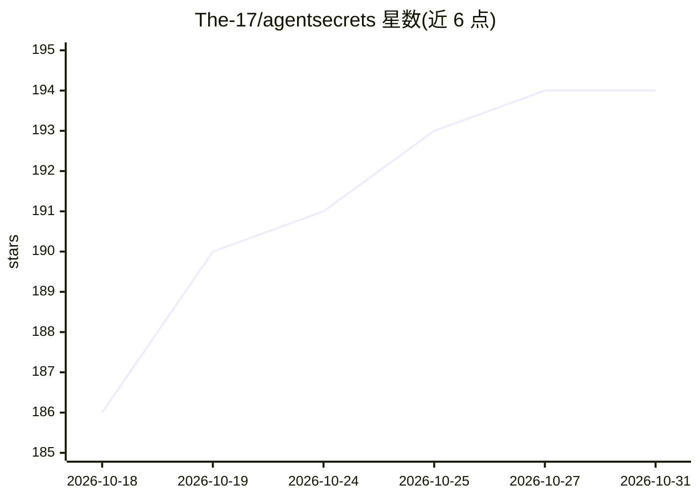

# The-17/agentsecrets

⭐ 194 · Go · MIT · 推送 2026-10-30 · [GitHub](https://github.com/The-17/agentsecrets) · [官网](https://agentsecrets.tech) · 个人维护

**面向 AI agent 的零知识凭证基础设施：agent 只引用键名不接触明文**

以 Go 编写的凭证管理与注入系统：agent 通过引用键名执行任务，值在 agent 之外解析并注入到传输层，凭证明文不进入 agent 上下文、内存或日志。提供六种认证注入方式、客户端加密（X25519、AES-256-GCM、Argon2id）、SSRF 防护、响应脱敏、基于进程哈希的 OS 钥匙串验证、加密 agent 身份令牌与 SHA-256 审计链。支持环境/团队隔离与客户端加密同步，可对接 MCP（Claude Desktop、Cursor）、OpenClaw、CLI 环境变量注入及供 LangChain/CrewAI/AutoGen 使用的 HTTP 代理，提供 Python SDK（JS/TS 开发中）。macOS/Linux 经 Homebrew 安装，开源服务端后端可自托管，MIT 许可。

## 筛选速览

| 维度 | 判定 | 备注 |
|---|---|---|
| AI 角色 | `ai-ecosystem` | LLM/agent 周边工具 |
| 许可风险 | `permissive` | MIT |
| 部署形态 | `None` |  |
| 模型依赖 | — | README 未给出锁定关系 |
| 硬件要求 | — | 无带数字的原话,不猜 |
| 安装摩擦 | `low` | 无编译、无系统依赖或容器化 |
| 成熟度 | — | 结构信号不足 |

## 能力要点

- 零知识注入：agent 只引用键名，值在传输层注入，明文不进 agent 上下文
- 客户端加密 X25519 / AES-256-GCM / Argon2id，服务端只存无法解密的密文
- 进程哈希验证的 OS 钥匙串访问控制与 SHA-256 审计链（日志无值字段）
- MCP 集成（Claude Desktop/Cursor）、环境变量注入、HTTP 代理与 Python SDK

## 适用场景

- 让 AI agent 调用 API 而不把密钥暴露给提示注入或恶意插件
- 团队/多环境（dev/staging/prod）零知识同步密钥
- 对 agent 每次凭证使用做可审计的身份追踪

## 场景标签

`网络安全` · 领域:学习与行业

## 证据(README 行号)

> L5: A unified enforcement pipeline that stores, injects, governs, and audits credentials without ever letting them enter
> L55: AgentSecrets connects to the tools you already use: MCP servers for Claude Desktop and Cursor, OpenClaw, environmen

## 星数曲线

2026-10-18 186 → 2026-10-31 194（+8）

---
*卡片 v1 · prompt 1.4 · 生成 2026-10-22 · 置信度 high · 依据 README sha `c7959933fcc6` · [字段定义](../../DATASET.md)*
