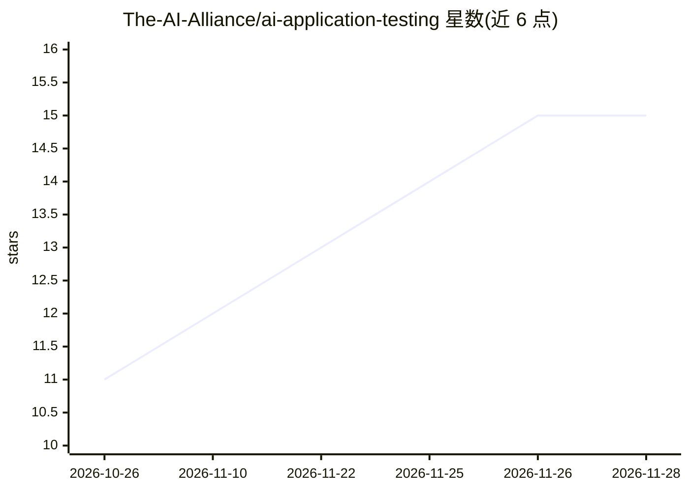

# The-AI-Alliance/ai-application-testing

⭐ 15 · Python · 推送 2026-11-17 · [GitHub](https://github.com/The-AI-Alliance/ai-application-testing) · [官网](https://the-ai-alliance.github.io/ai-application-testing/) · 组织维护

**生成式 AI 应用开发者测试方法指南与工具集**

AI Alliance 发布的用户指南与配套工具仓库，探讨当生成式 AI 引入非确定性输出时，如何为企业开发者编写可重复、可靠、自动化的测试（如单元测试）。内容以 GitHub Pages 用户指南（docs 目录）与示例代码（src 目录）组织，提供 Makefile 统一管理任务；附带一个仅供教学用途的医疗 ChatBot 示例应用，明确声明不可用于真实医疗场景。工具用 Python 编写，依赖 uv 管理环境，通过 LiteLLM 灵活调用不同推理服务，默认搭配 ollama 本地推理。

## 筛选速览

| 维度 | 判定 | 备注 |
|---|---|---|
| AI 角色 | `ai-ecosystem` | LLM/agent 周边工具 |
| 许可风险 | `none` | — |
| 部署形态 | `library` | 以包/库形式分发 |
| 模型依赖 | local-ok | 支持本地模型 |
| 硬件要求 | — | 无带数字的原话,不猜 |
| 安装摩擦 | `medium` | 含编译或系统依赖之一 |
| 成熟度 | — | 结构信号不足 |

## 能力要点

- 针对 Gen AI 非确定性输出的可重复测试方法与工具
- Makefile 目标封装一次性环境配置与工具运行
- 通过 LiteLLM 支持切换不同推理服务（OpenAI/Anthropic/ollama）
- 含医疗 ChatBot 教学示例应用与全部实验所用模型表

## 适用场景

- 为调用 LLM 的应用编写可重复的自动化测试
- 在多个本地模型上对比测试结果
- 学习生成式 AI 应用的测试概念与实践流程

## 场景标签

`模型评测` · 领域:评测与运维

## 证据(README 行号)

> L5: This repo contains the code and documentation for the AI Alliance user guide and tools for _Testing Generative AI Ap
> L51: One of the dependencies managed with `uv` is `LiteLLM`, the library we use for flexible invocation of different inf
> L142: Now you are set up and you can use `make` to run the tools discussed and also the complete example ChatBot applica

## 星数曲线

2026-10-26 11 → 2026-11-28 15（+4）

---
*卡片 v1 · prompt 1.4 · 生成 2026-11-18 · 置信度 mid · 依据 README sha `2cc939fc0062` · [字段定义](../../DATASET.md)*
