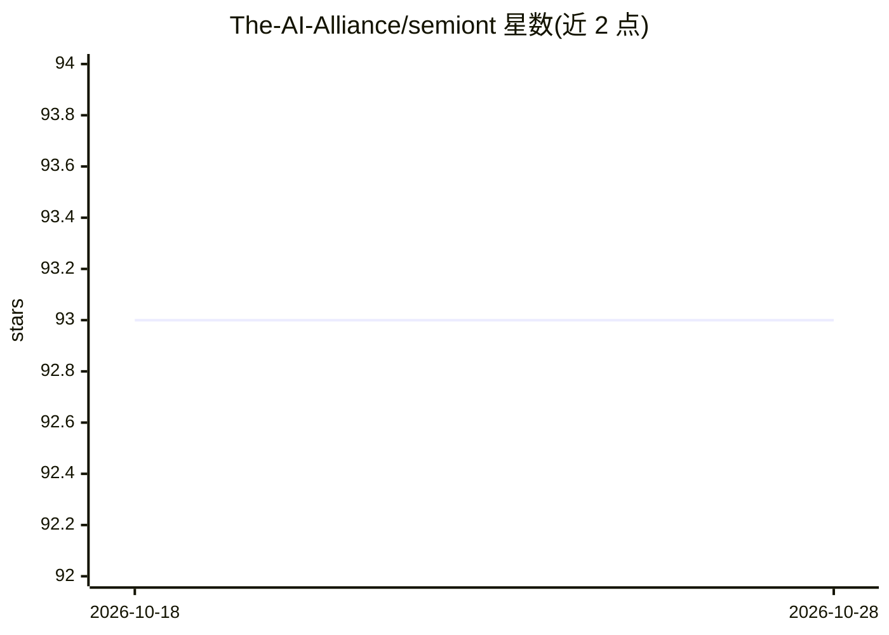

# The-AI-Alliance/semiont

⭐ 93 · TypeScript · Apache-2.0 · 推送 2026-10-28 · [GitHub](https://github.com/The-AI-Alliance/semiont) · [官网](https://the-ai-alliance.github.io/semiont/) · 组织维护

**人类与 AI 共用的语义知识库平台：标注、连接与治理领域知识**

开源的、以来源为据的语义知识平台，用于构建和维护可信的 AI 知识库与上下文层。为人类与 AI agent 提供共享工作区：标注文档、连接知识、富集与治理领域知识。包含浏览器界面（文档引用高亮与评估面板）、可运行的知识库，以及 TypeScript/Rust/Python SDK 与统一协议，面向分析师、运营者、构建者与贡献者四类角色。通过 Homebrew 安装，Apache 2.0 许可。

## 筛选速览

| 维度 | 判定 | 备注 |
|---|---|---|
| AI 角色 | `ai-ecosystem` | LLM/agent 周边工具 |
| 许可风险 | `permissive` | Apache-2.0 |
| 部署形态 | `None` |  |
| 模型依赖 | — | README 未给出锁定关系 |
| 硬件要求 | — | 无带数字的原话,不猜 |
| 安装摩擦 | `low` | 无编译、无系统依赖或容器化 |
| 成熟度 | — | 结构信号不足 |

## 能力要点

- 来源为据的语义知识库与上下文层构建
- 人类与 AI agent 共享工作区：标注、连接、富集、治理知识
- 浏览器界面：文档引用高亮与评估面板
- TypeScript/Rust/Python SDK，遵循统一协议

## 适用场景

- 团队与 AI agent 协作维护领域知识库/Wiki/上下文图谱
- 为 AI 应用与 agent 提供可信的知识上下文层
- 分析师审阅 AI agent 提出的知识标注与提案

## 场景标签

`知识库管理` `Agent 记忆` · 领域:Agent 开发

## 证据(README 行号)

> L5: **Semiont is an open, source-grounded semantic knowledge platform for building and maintaining trusted AI knowledge 
> L21: - **Builder**: build an application, a script or an agent on the SDK, in TypeScript, Rust or Python, to the protoco

## 星数曲线

2026-10-18 93 → 2026-10-28 93（+0）

---
*卡片 v1 · prompt 1.4 · 生成 2026-10-23 · 置信度 high · 依据 README sha `efd1eb305d72` · [字段定义](../../DATASET.md)*
