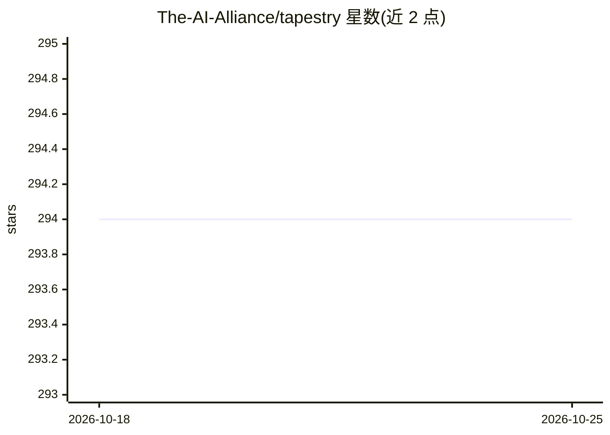

# The-AI-Alliance/tapestry

⭐ 294 · Python · 推送 2026-10-23 · [GitHub](https://github.com/The-AI-Alliance/tapestry) · [官网](https://thealliance.ai/projects/tapestry/) · 组织维护

**多方主权 AI 联盟：共同训练基础模型并构建衍生模型**

The AI Alliance 发起的全球联盟项目：伙伴组织与个人贡献数据集和算力，共同训练新的基础模型家族；数据与算力所有权保留在伙伴方，伙伴可基于联盟训练的底座模型，用 Tapestry 的开源训练平台构建自有主权衍生模型。当前工作流包括基于 Inglehart–Welzel 文化地图的 LLM 文化对齐、结合联邦学习的联盟训练、合规数据语料建设。仓库提供训练原型代码（src/tapestry/training/consortium/）、可运行示例与架构文档，使用 uv 与 GNU make 进行开发，处于早期协作建设阶段。

## 筛选速览

| 维度 | 判定 | 备注 |
|---|---|---|
| AI 角色 | `ai-ecosystem` | LLM/agent 周边工具 |
| 许可风险 | `none` | — |
| 部署形态 | `library` | 以包/库形式分发 |
| 模型依赖 | — | README 未给出锁定关系 |
| 硬件要求 | — | 无带数字的原话,不猜 |
| 安装摩擦 | `low` | 无编译、无系统依赖或容器化 |
| 成熟度 | `idea` | |

## 能力要点

- 伙伴共同训练基础模型家族，数据与算力所有权归伙伴方
- 开源训练平台支持构建伙伴自有的主权衍生模型
- 联盟训练原型代码位于 src/tapestry/training/consortium/，附 make consortium-demo 可运行示例
- 工作流涵盖 LLM 文化对齐（Inglehart–Welzel 地图为初始度量）与联邦学习思路的分布式训练

## 适用场景

- 机构加入联盟贡献数据与算力并获取主权衍生模型
- 研究人员参与文化对齐、联盟训练、数据合规等方向共建
- 查阅主权 AI 联盟训练的架构文档与技术要求

## 场景标签

`模型训练` `微调` · 领域:训练与推理

## 证据(README 行号)

> L6: > Project Tapestry is a global consortium of partner organizations and individuals who bring expertise, data sets, a
> L8: > Our aim is to enable truly _sovereign AI_ by ensuring that ownership of data and compute remains with partners, an

## 星数曲线

2026-10-18 294 → 2026-10-25 294（+0）

---
*卡片 v1 · prompt 1.4 · 生成 2026-10-23 · 置信度 mid · 依据 README sha `cebce11e18b6` · [字段定义](../../DATASET.md)*
