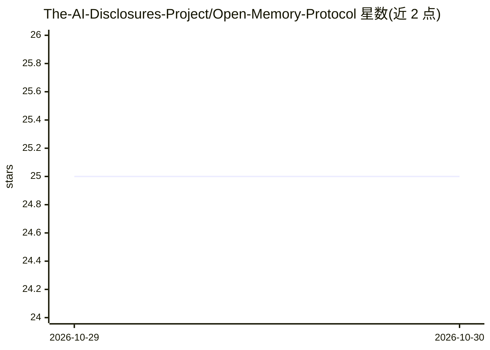

# The-AI-Disclosures-Project/Open-Memory-Protocol

⭐ 25 · Python · Apache-2.0 · 推送 2026-10-28 · [GitHub](https://github.com/The-AI-Disclosures-Project/Open-Memory-Protocol) · [官网](https://openmemoryprotocol.org) · 组织维护

**多方共治的智能体记忆开放协议倡议：让记忆跨系统迁移共享**

Open Memory Protocol Initiative（OMPI）由 AI Disclosures Project 主办、IBM 与 Mozilla 联合发起，目标是制定智能体记忆（agent memory）的开放协议，使记忆可在不同智能体系统间迁移与共享。仓库汇集规范草案（Letta v0.2、IBM v0.1、Cognee、me.md 等提案）、治理文档与 Python 原型（加载器/校验器、MCP 记忆服务器）。首个落地方向为编码智能体的记忆迁移（Claude Code、Codex、goose、Letta Code）。当前状态 pre-1.0，尚无参考实现，规范仍在公开评审中。

## 筛选速览

| 维度 | 判定 | 备注 |
|---|---|---|
| AI 角色 | `ai-ecosystem` | LLM/agent 周边工具 |
| 许可风险 | `permissive` | Apache-2.0 |
| 部署形态 | `None` |  |
| 模型依赖 | — | README 未给出锁定关系 |
| 硬件要求 | — | 无带数字的原话,不猜 |
| 安装摩擦 | `low` | 无编译、无系统依赖或容器化 |
| 成熟度 | `idea` | |

## 能力要点

- 统一记忆对象、交换格式与运行时表示的草案规范（v0.2 公开评审中）
- 汇集多家提案：Letta、IBM、Cognee/COGX、me.md 等
- 含 Python 加载器/校验器原型与覆盖 12 种编码智能体的会话索引原型
- 仿 W3C/IETF 的成员共治治理模式（Mozilla、IBM、Letta 占席）

## 适用场景

- 让编码智能体（Claude Code/Codex/goose 等）之间迁移记忆
- 企业更换记忆供应商时保留累积的智能体上下文
- 跟踪智能体记忆互操作协议的规范进展并参与提案评审

## 场景标签

`Agent 记忆` · 领域:Agent 开发

## 证据(README 行号)

> L37: The **Open Memory Protocol Initiative (OMPI)** is the multi-stakeholder, vendor-neutral open-source ecosystem with 
> L59: The fragmentation has real engineering and security costs. Developers write bespoke adapters. Users and enterprises

## 星数曲线

2026-10-29 25 → 2026-10-30 25（+0）

---
*卡片 v1 · prompt 1.4 · 生成 2026-10-28 · 置信度 high · 依据 README sha `ea0a31c4d16a` · [字段定义](../../DATASET.md)*
