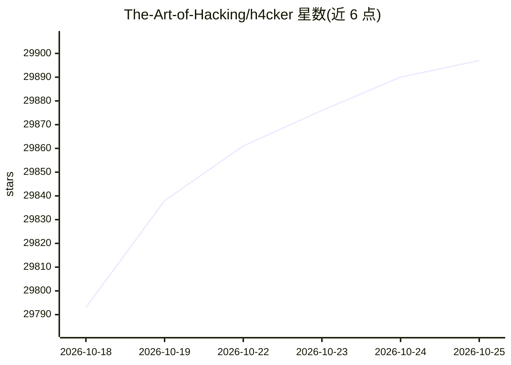

# The-Art-of-Hacking/h4cker

⭐ 29,897 · Jupyter Notebook · MIT · 推送 2026-10-23 · [GitHub](https://github.com/The-Art-of-Hacking/h4cker) · [官网](https://hackerrepo.org) · 个人维护

**为安全从业者提供网络安全资源聚合清单**

由 Omar Santos 维护的网络安全资源聚合仓库，收录与伦理黑客、漏洞赏金、数字取证与应急响应、AI 安全、漏洞研究、漏洞利用开发、逆向工程相关的参考、脚本、工具、实验与培训材料。内容按目录组织：网络安全领域分类、AI 安全与 LLM 工程、认证路线图、自建实验室与培训参考。作为其书籍、视频课程与线下培训的补充资料，通过 MIT 许可开源，使用方式为按目标进入对应领域页面后跟随链接。

## 筛选速览

| 维度 | 判定 | 备注 |
|---|---|---|
| AI 角色 | `ai-knowledge` | 知识聚合/清单类 |
| 许可风险 | `permissive` | MIT |
| 部署形态 | `None` |  |
| 模型依赖 | — | README 未给出锁定关系 |
| 硬件要求 | — | 无带数字的原话,不猜 |
| 安装摩擦 | `low` | 无编译、无系统依赖或容器化 |
| 成熟度 | — | 结构信号不足 |

## 动量与使用信号

- 维护:`active` — 距上次 push 5.3 天,年发版 0,57 位贡献者
- 涨星:近 1 天 **+22**(自 20261016 起算)

## 能力要点

- 覆盖攻防、云与容器、应用安全、AI 安全等领域分类目录
- 含 AI 安全、LLM 工程、AI 辅助应急响应资源板块
- 认证备考资料单独分组（Cisco/CompTIA/ISC2 等）
- 提供自建实验室与 cyber range 资源章节

## 适用场景

- 按领域查找安全工具、脚本与实验资源
- 备考安全认证时查找路线图与考试补充材料
- 搭建自己的安全实验/cyber range 环境
- 查找 AI 安全与 LLM 工程相关参考

## 场景标签

`精选清单` `网络安全` · 领域:学习与行业

## 证据(README 行号)

> L3: This repository is a comprehensive collection of cybersecurity references, scripts, tools, code, labs, and training 
> L7: The repository serves as supplemental material for books, video courses, and live training created by Omar Santos. I
> L12: - **AI**: ai contains AI security, LLM engineering, AI-assisted incident response and automation, and AI ethics/pri

## 星数曲线

2026-10-18 29,793 → 2026-10-25 29,897（+104）

---
*卡片 v1 · prompt 1.4 · 生成 2026-10-18 · 置信度 high · 依据 README sha `cf3ed11349ee` · [字段定义](../../DATASET.md)*
