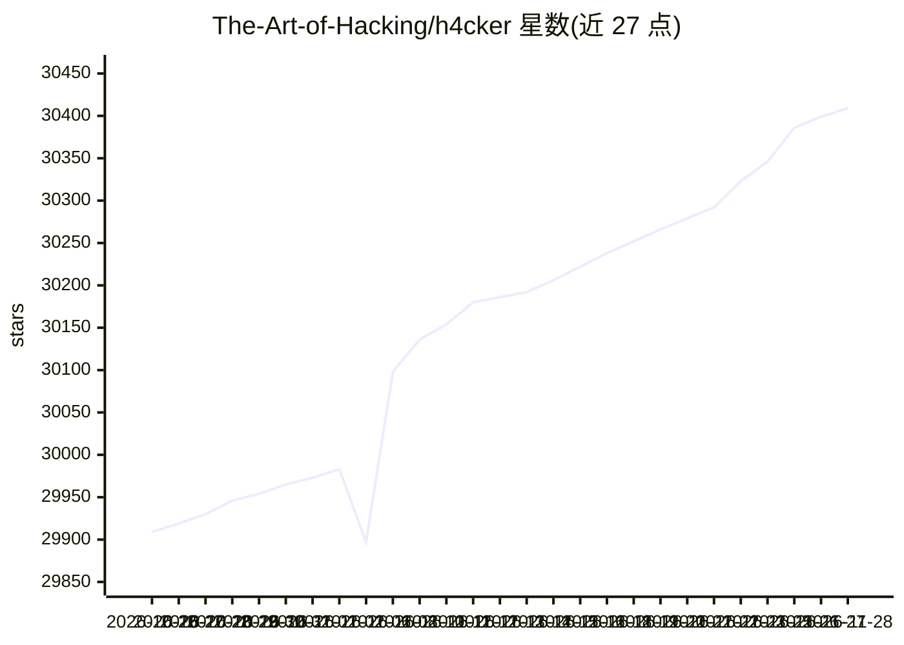

# The-Art-of-Hacking/h4cker

⭐ 30,409 · Jupyter Notebook · MIT · 推送 2026-11-17 · [GitHub](https://github.com/The-Art-of-Hacking/h4cker) · [官网](https://hackerrepo.org) · 个人维护

**面向安全从业者的网络安全资源聚合清单（含 AI 安全）**

由 Omar Santos 维护的网络安全资源合集，收录参考资料、脚本、工具、代码、实验与培训资源，作为其书籍、视频课程与培训的补充材料。目录按领域组织：进攻/防御安全、云与容器安全、应用安全、AI 安全（含 LLM 工程、AI 辅助事件响应、AI 伦理/隐私/治理）、认证路线图、自建实验环境与速查表。使用方式为按领域入口页浏览链接；以 MIT 许可发布。

## 筛选速览

| 维度 | 判定 | 备注 |
|---|---|---|
| AI 角色 | `ai-knowledge` | 知识聚合/清单类 |
| 许可风险 | `permissive` | MIT |
| 部署形态 | `None` |  |
| 模型依赖 | — | README 未给出锁定关系 |
| 硬件要求 | — | 无带数字的原话,不猜 |
| 安装摩擦 | `low` | 无编译、无系统依赖或容器化 |
| 成熟度 | — | 结构信号不足 |

## 动量与使用信号

- 维护:`active` — 距上次 push 5.3 天,年发版 0,57 位贡献者
- 涨星:近 1 天 **+22**(自 20261016 起算)

## 能力要点

- 覆盖进攻/防御安全、云容器、应用安全等领域的分类目录
- AI 目录含 AI 安全、LLM 工程、AI 辅助事件响应与 AI 治理资源
- 认证专区集中管理考试备考材料
- 提供实验环境（lab/cyber range）搭建资源

## 适用场景

- 按领域查找安全学习资料与工具索引
- 备考 Cisco/CompTIA/ISC2 等安全认证
- 搭建自己的安全实验环境
- 查找 AI 安全与 LLM 工程相关参考

## 场景标签

`精选清单` `网络安全` `教程课程` · 领域:学习与行业

## 证据(README 行号)

> L3: This repository is a comprehensive collection of cybersecurity references, scripts, tools, code, labs, and training 
> L12: - **AI**: ai contains AI security, LLM engineering, AI-assisted incident response and automation, and AI ethics/pri

## 星数曲线

2026-10-26 29,909 → 2026-11-28 30,409（+500）

---
*卡片 v1 · prompt 1.4 · 生成 2026-11-22 · 置信度 high · 依据 README sha `9431677d2a32` · [字段定义](../../DATASET.md)*
