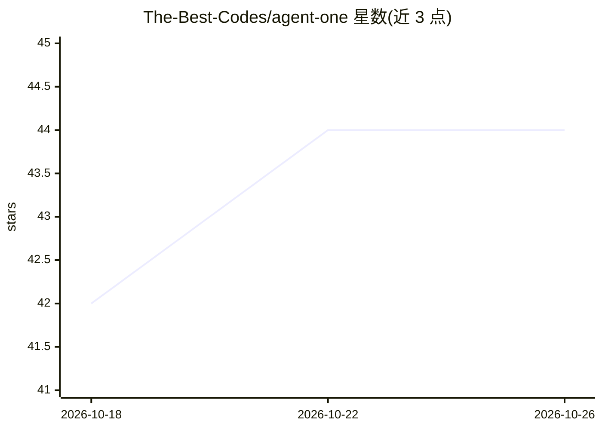

# The-Best-Codes/agent-one

⭐ 44 · TypeScript · AGPL-3.0 · 推送 2026-10-20 · [GitHub](https://github.com/The-Best-Codes/agent-one) · [官网](https://www.agent-one.dev) · 个人维护

**免费开源桌面 AI agent，支持万级模型与扩展**

基于 Tauri 2 (Rust) + React 的跨平台（Windows/macOS/Linux）桌面 AI agent 与深度研究工具。通过内置 70+ 提供商接入 10,000+ AI 模型（模型目录每 24 小时自动更新），并支持任意 OpenAI 兼容提供商；扩展体系基于 MCP 协议，内置 20,000+ 扩展（MCP 官方注册表浏览，自建注册表处于私测）。支持 BYO API key、Ollama/LM Studio 本地模型、子 agent、多会话、本地运行数据。提供免费计划与账号可选登录；构建细节文档尚未提供（coming soon）。

## 筛选速览

| 维度 | 判定 | 备注 |
|---|---|---|
| AI 角色 | `ai-native` | 本体是模型或模型工具 |
| 许可风险 | `viral` | AGPL-3.0 |
| 部署形态 | `None` |  |
| 模型依赖 | local-ok | 支持本地模型 |
| 硬件要求 | — | 无带数字的原话,不猜 |
| 安装摩擦 | `low` | 无编译、无系统依赖或容器化 |
| 成熟度 | `idea` | |

## 能力要点

- 70+ 内置提供商接入 10,000+ 模型，目录每 24 小时自动更新
- 基于 MCP 的 20,000+ 扩展浏览与连接，含 MCP Apps（beta）
- BYO key（OpenRouter/Groq/Google 等）与 Ollama/LM Studio 本地模型
- Tauri 2 桌面应用，数据本地运行，跨设备同步需登录

## 适用场景

- 在桌面端使用多提供商模型进行对话与深度研究
- 通过 MCP 扩展连接外部应用与服务完成任务
- 用自己的 API key 或本地模型运行 agent

## 场景标签

`AI 助手` · 领域:对话与助手

## 证据(README 行号)

> L5:  A free AI agent and deep-researcher.
> L26: AgentOne also supports over **10,000+ AI models** from 70+ built-in providers, powered by the AI Model Directory. B
> L30: Importantly, AgentOne is a desktop app. There are currently no plans for a CLI. I may add a mobile app in the futur

## 星数曲线

2026-10-18 42 → 2026-10-26 44（+2）

---
*卡片 v1 · prompt 1.4 · 生成 2026-10-25 · 置信度 high · 依据 README sha `3f4454ef384f` · [字段定义](../../DATASET.md)*
