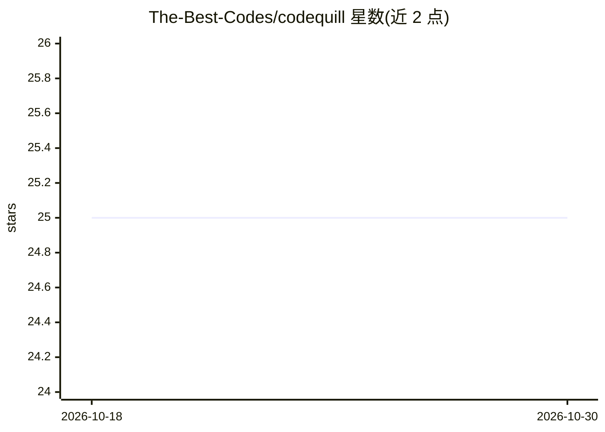

# The-Best-Codes/codequill

⭐ 25 · TypeScript · MIT · 推送 2026-02-02 · [GitHub](https://github.com/The-Best-Codes/codequill) · 个人维护

**基于 Tauri 2 的桌面代码片段管理与编辑器，支持预览**

使用 Tauri 2 + React 构建的跨平台桌面应用：内置 Monaco 编辑器，支持 90+ 编程语言语法高亮，提供 Markdown 与 HTML 实时预览，用于创建、组织和搜索代码片段。分发渠道包括 .deb/.msi/.exe/.dmg 安装包与 Snap Store（Flathub 标注为即将上线）。v1 与 v2 版本不兼容，迁移需手动处理数据。README 未描述任何 AI 功能实现，主题标签中的 ai 未见正文对应说明。

## 筛选速览

| 维度 | 判定 | 备注 |
|---|---|---|
| AI 角色 | `ai-enhanced` | 去掉 AI 部分产品仍成立 |
| 许可风险 | `permissive` | MIT |
| 部署形态 | `desktop` | 安装包/桌面程序 |
| 模型依赖 | — | README 未给出锁定关系 |
| 硬件要求 | — | 无带数字的原话,不猜 |
| 安装摩擦 | `low` | 无编译、无系统依赖或容器化 |
| 成熟度 | — | 结构信号不足 |

## 能力要点

- 内置 Monaco 编辑器，支持 90+ 语言语法高亮
- Markdown 与 HTML 内置实时预览
- 多平台安装包（.deb/.msi/.exe/.dmg）及 Snap Store 分发

## 适用场景

- 集中保存和管理常用代码片段
- 在应用内直接编辑并预览 Markdown/HTML 文件
- 在 Linux 上通过 Snap 或 deb 包安装使用

## 场景标签

 · 领域:开发者工具/桌面应用

## 证据(README 行号)

> L11: Built with Tauri 2, CodeQuill offers a rich editing experience with syntax highlighting for over 90 programming lan
> L112: CodeQuill's core is a fully-featured text editor, Monaco, providing a smooth and responsive coding experience.

## 星数曲线

2026-10-18 25 → 2026-10-30 25（+0）

---
*卡片 v1 · prompt 1.4 · 生成 2026-10-27 · 置信度 low · 依据 README sha `d5b09f97b24b` · [字段定义](../../DATASET.md)*
