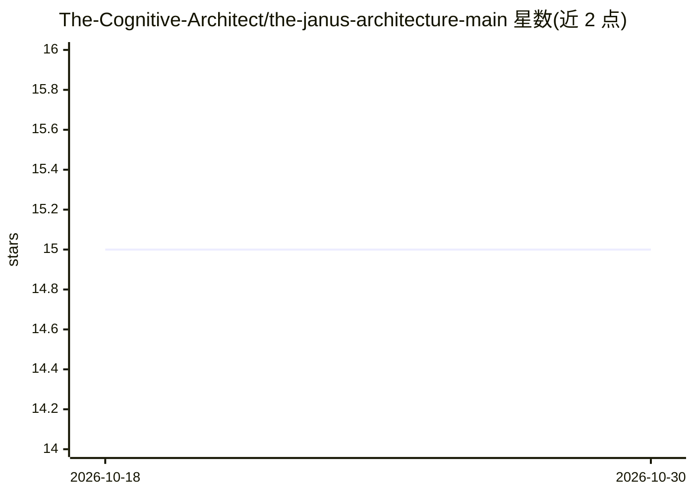

# The-Cognitive-Architect/the-janus-architecture-main

⭐ 15 · Python · 推送 2026-10-08 · [GitHub](https://github.com/The-Cognitive-Architect/the-janus-architecture-main) · [官网](anthonyjanus.com) · 个人维护

**物理认知机体架构的论著仓库：发布规格专著与设计档案**

围绕"Janus Machine"这一硬件优先认知架构的出版物与研发档案仓库。核心为 199 页专著《The Janus Architecture》，规定双 DC/AC 网格模拟基底、代谢能量经济（含生死机制）、经验遗传架构与生态扩展四部分；另收录奠基论文、白皮书、33 项跨学科诊断汇合等文献，以及早期设计笔记、原理图、视频等历史材料。物理原型正在研制（DC 网格与代谢电路优先），配套自制 CNC 与绕线机。专利申请中，仓库内材料采用多种许可。

## 筛选速览

| 维度 | 判定 | 备注 |
|---|---|---|
| AI 角色 | `ai-knowledge` | 知识聚合/清单类 |
| 许可风险 | `none` | — |
| 部署形态 | `None` |  |
| 模型依赖 | — | README 未给出锁定关系 |
| 硬件要求 | — | 无带数字的原话,不猜 |
| 安装摩擦 | `low` | 无编译、无系统依赖或容器化 |
| 成熟度 | — | 结构信号不足 |

## 能力要点

- 199 页架构专著：物理基底/代谢/遗传/生态四部分完整规格
- 提出基底构成认知、生态对齐、可遗传超智能等可检验主张
- 收录论文、白皮书、早期设计笔记与 Resonance Chamber 概念验证档案
- 美国临时专利申请中（64/066,230，130 页技术披露）

## 适用场景

- 查阅物理认知机体架构的完整规格与主张
- 研究具身认知/模拟计算方向的架构设计参考
- 追溯项目历史设计材料与概念验证记录

## 场景标签

`科研工具` · 领域:学习与行业

## 证据(README 行号)

> L15: The first published architectural volume is a 199-page monograph:
> L68: - **publications/** — published research papers, organized by work with their individual license files.
> L85: |**The Janus Architecture** (2026)|Complete specification - 199 pages, four parts, two appendices|DOI · Repository 

## 星数曲线

2026-10-18 15 → 2026-10-30 15（+0）

---
*卡片 v1 · prompt 1.4 · 生成 2026-10-30 · 置信度 high · 依据 README sha `4a3746703503` · [字段定义](../../DATASET.md)*
