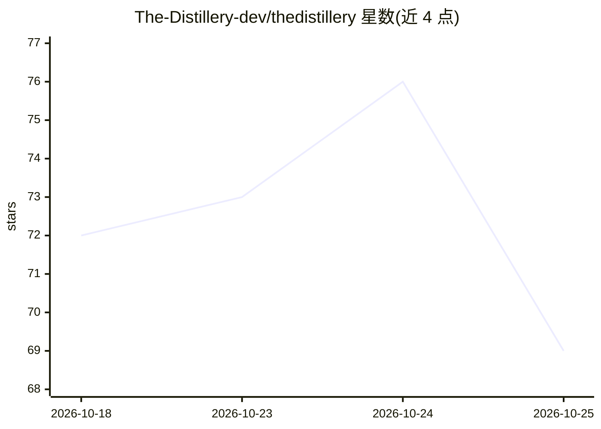

# The-Distillery-dev/thedistillery

⭐ 71 · TypeScript · NOASSERTION · 推送 2026-07-12 · [GitHub](https://github.com/The-Distillery-dev/thedistillery) · [官网](https://thedistillery.dev) · 组织维护

**本地 token 优化代理：削减 AI 编码工具发往模型的输入 token**

面向 AI 编码工具开发者的本地代理，运行于编码 agent 与模型 API 之间，通过去重、工具输出蒸馏、上下文保留与缓存断点放置四种机制削减输入 token，并统计会话级输入削减量；输出 token 原样流回。自动配置 Claude Code 路由，也支持自定义 Anthropic 或 OpenAI 兼容 base URL 的客户端（Cline、Goose、Zed、Aider、Codex CLI）。优化在本地运行，托管服务仅接收用量元数据；代理默认仅绑定回环地址。需 Node.js 20.9+，存在付费计划功能（自动缓存断点）。

## 筛选速览

| 维度 | 判定 | 备注 |
|---|---|---|
| AI 角色 | `ai-ecosystem` | LLM/agent 周边工具 |
| 许可风险 | `none` | NOASSERTION |
| 部署形态 | `library` | 以包/库形式分发 |
| 模型依赖 | locked-api |  |
| 硬件要求 | — | 无带数字的原话,不猜 |
| 安装摩擦 | `low` | 无编译、无系统依赖或容器化 |
| 成熟度 | — | 结构信号不足 |

## 能力要点

- 四种优化机制：去重、工具输出蒸馏、保留策略、缓存断点放置
- 自动配置 Claude Code，支持 6 种客户端接入方式
- light/smart/deep 三档预设，.distilleryrc.json 项目级配置
- 优化本地运行，托管服务不接收代码与提示词

## 适用场景

- 降低 Claude Code 等 AI 编码工具的模型费用
- 长会话中控制上下文体积避免超限
- 统计各会话的输入 token 削减量

## 场景标签

`模型网关` · 领域:Agent 开发

## 证据(README 行号)

> L5: The Distillery is a local token-optimization proxy for AI coding tools. It sits between your coding agent and the mo
> L28: `thedistillery start` binds to `127.0.0.1:3080` by default and automatically configures Claude Code routing. For ot

## 星数曲线

2026-10-18 72 → 2026-10-25 69（-3）

---
*卡片 v1 · prompt 1.4 · 生成 2026-10-24 · 置信度 high · 依据 README sha `7ea7490a656d` · [字段定义](../../DATASET.md)*
