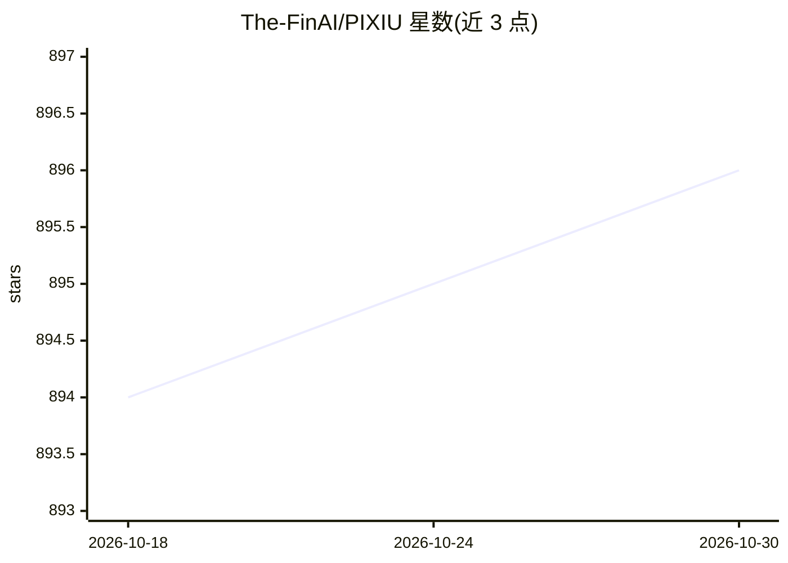

# The-FinAI/PIXIU

⭐ 896 · Jupyter Notebook · MIT · 推送 2026-10-08 · [GitHub](https://github.com/The-FinAI/PIXIU) · [官网](https://huggingface.co/collections/TheFinAI/finben-and-pixiu-english-financial-evaluation-658f515911f68f12ea193194) · 组织维护 · 中文 README

**金融领域 LLM 评测基准、指令数据集与微调模型的开放资源**

PIXIU 聚合三大组件：FinBen 金融语言理解与预测评测基准（覆盖情感分析、NER、问答、文本摘要、信用评分、股价预测等约 35 个数据集）、FIT 多任务多模态金融指令数据集、以及在其上微调的金融 LLM FinMA（7B NLP 版与 Full 版）。模型、指令数据与评测数据集均开放发布于 Hugging Face，提供英文/中文/西班牙文评测集合，论文发表于 NeurIPS 2023 Datasets and Benchmarks Track。代码仓库支持源码、pip 与 Docker 方式运行评测。

## 筛选速览

| 维度 | 判定 | 备注 |
|---|---|---|
| AI 角色 | `ai-knowledge` | 知识聚合/清单类 |
| 许可风险 | `permissive` | MIT |
| 部署形态 | `self-host` | docker 或自建部署 |
| 模型依赖 | — | README 未给出锁定关系 |
| 硬件要求 | — | 无带数字的原话,不猜 |
| 安装摩擦 | `low` | 无编译、无系统依赖或容器化 |
| 成熟度 | — | 结构信号不足 |

## 能力要点

- FinBen 基准覆盖情感分析、知识抽取、问答、信用评分、股价预测等多类金融任务
- FIT 多任务多模态指令数据集，含时间序列与报告/新闻/推文/监管文件等文本
- FinMA 金融 LLM（7B NLP/Full 版本）开放于 Hugging Face
- 评测集合覆盖英文、中文、西班牙文三种语言

## 适用场景

- 对金融 LLM 在理解与预测任务上做系统性评测对比
- 获取金融指令数据集用于微调自己的模型
- 在 Open FinLLM Leaderboard 上查看各模型金融任务成绩

## 场景标签

`模型评测` `金融量化` · 领域:评测与运维

## 证据(README 行号)

> L86: Welcome to the **PIXIU** project! PIXIU supports the development, fine-tuning, and evaluation of large language mod
> L92: - **FinBen**: Our Financial Language Understanding and Prediction Evaluation Benchmark. FinBen serves as the evalua
> L93: - **FIT**: Our Financial Instruction Dataset. FIT is a multi-task and multi-modal instruction dataset specifically 

## 星数曲线

2026-10-18 894 → 2026-10-30 896（+2）

---
*卡片 v1 · prompt 1.4 · 生成 2026-10-21 · 置信度 high · 依据 README sha `d05bd2e02615` · [字段定义](../../DATASET.md)*
