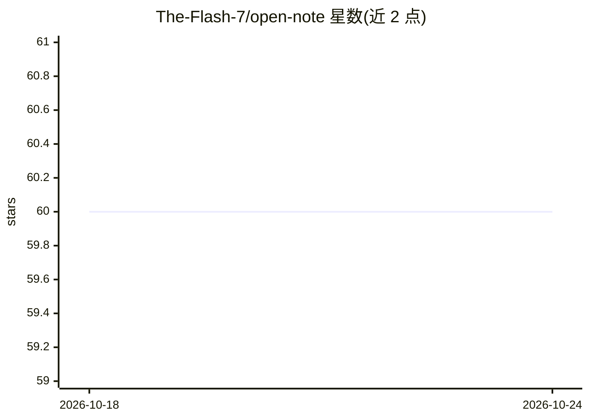

# The-Flash-7/open-note

⭐ 60 · Dart · NOASSERTION · 推送 2026-09-03 · [GitHub](https://github.com/The-Flash-7/open-note) · [官网](https://opennote.zsdn.net) · 个人维护 · 中文 README

**带 AI 助手与本地知识库的跨平台智能笔记应用**

基于 Flutter + Python(FastAPI) 的跨平台笔记应用：支持 Markdown、富文本、纯文本、代码四种编辑格式，树形分类与标签管理。核心 AI 部分为 Cici Agent 助手，基于 ReAct 推理引擎提供 21 个自动化技能（搜索、编辑、合并、问答、总结等），并带自动记忆提取与置信度衰减的记忆系统。检索采用 ChromaDB + 本地 ONNX 运行的 embeddinggemma-300m 嵌入模型，关键词与语义 RRF 混合搜索。支持 MCP 协议与 CLI，预设接入多家云端/本地 AI 服务商。安装包从 Releases 下载，需配置 AI 提供商后使用。

## 筛选速览

| 维度 | 判定 | 备注 |
|---|---|---|
| AI 角色 | `ai-enhanced` | 去掉 AI 部分产品仍成立 |
| 许可风险 | `permissive` | NOASSERTION |
| 部署形态 | `library` | 以包/库形式分发 |
| 模型依赖 | local-ok | 支持本地模型 |
| 硬件要求 | — | 无带数字的原话,不猜 |
| 安装摩擦 | `low` | 无编译、无系统依赖或容器化 |
| 成熟度 | — | 结构信号不足 |

## 能力要点

- ReAct 推理引擎驱动 21 个笔记自动化技能的 Agent 助手
- 本地 ONNX 运行 embeddinggemma-300m，ChromaDB 关键词+语义 RRF 混合搜索
- 自动记忆提取（画像/事实/经验）与置信度衰减遗忘策略
- 支持 MCP 协议、CLI 命令行工具与自定义 OpenAI 兼容 API

## 适用场景

- 日常笔记记录与多格式编辑管理
- 基于个人笔记库做自然语言问答与语义检索
- 让 AI 助手代为执行笔记的新建、合并、润色与总结

## 场景标签

`知识库管理` `语义搜索` · 领域:知识与检索

## 证据(README 行号)

> L44: > 一款拥有长期记忆和自我进化能力的跨平台智能笔记 Agent，内置聪明又贴心的智能 AI 助手 Cici。得益于巧妙的`记忆提取-经验总结-自我反省-知识整理-召回反哺`的闭环进化架构设计，你的 Cici 会越来越懂你，越用越默
> L52: - **4 种编辑格式**：Markdown、富文本 (Quill)、纯文本、代码编辑器（语法高亮）
> L112: - **多 AI 提供商**：DeepSeek、OpenAI、Claude (Anthropic)、百炼、智谱、百度、混元、Kimi、火山、Ollama (本地)、自定义兼容 API

## 星数曲线

2026-10-18 60 → 2026-10-24 60（+0）

---
*卡片 v1 · prompt 1.4 · 生成 2026-10-24 · 置信度 high · 依据 README sha `f002372b587d` · [字段定义](../../DATASET.md)*
