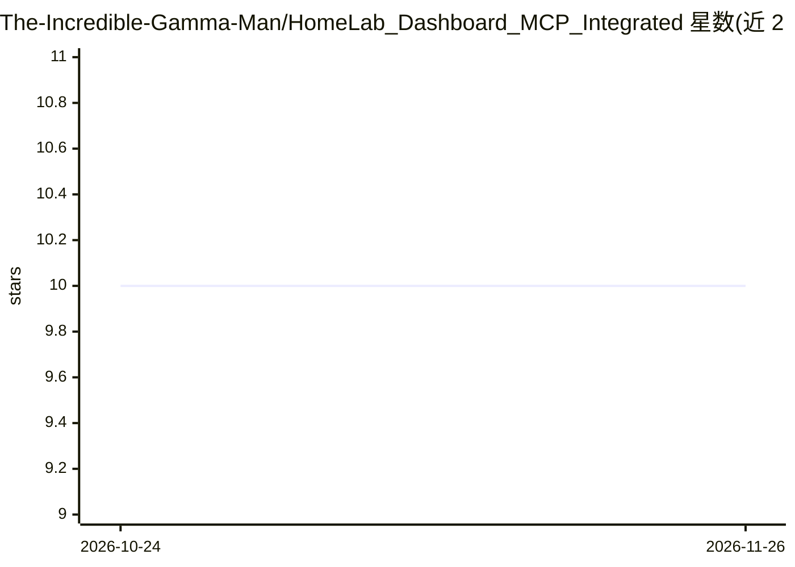

# The-Incredible-Gamma-Man/HomeLab_Dashboard_MCP_Integrated

⭐ 10 · Shell · MIT · 推送 2026-04-01 · [GitHub](https://github.com/The-Incredible-Gamma-Man/HomeLab_Dashboard_MCP_Integrated) · 个人维护

**可完全离线运行的自托管 Homelab 仪表盘，内置 MCP Agent AI**

基于 Homarr 构建的家用服务器仪表盘方案，用 Caddy 反向代理子网内全部 Docker 容器并以自签名证书强制 HTTPS，Keycloak 提供单点登录与用户组管理。预配置 Nextcloud、GitLab、Trilium、Portainer、Open WebUI、Restreamer 等应用；Open WebUI 通过 MCP 连接 Ollama 模型，跨应用执行自动化任务。支持完全离线/气隙运行，可选 ZeroTier/Tailscale VPN 远程访问，通过脚本与 docker-compose 启动，在 Debian 上经过测试。

## 筛选速览

| 维度 | 判定 | 备注 |
|---|---|---|
| AI 角色 | `ai-enhanced` | 去掉 AI 部分产品仍成立 |
| 许可风险 | `permissive` | MIT |
| 部署形态 | `self-host` | docker 或自建部署 |
| 模型依赖 | local-ok | 支持本地模型 |
| 硬件要求 | — | 无带数字的原话,不猜 |
| 安装摩擦 | `low` | 无编译、无系统依赖或容器化 |
| 成熟度 | — | 结构信号不足 |

## 能力要点

- Open WebUI + Ollama 经 MCP 提供 Agent AI 自动化
- Keycloak 集中单点登录与用户/组管理
- Caddy 反代 + 自签名证书强制 HTTPS
- 完全离线（airgapped）运行，容器化模块化部署

## 适用场景

- 无外网环境下集中管理自托管服务
- 为家庭服务器统一配置 SSO 与 HTTPS
- 用本地 Ollama 模型跨应用执行 AI 自动化任务
- 在 Homelab 仪表盘中监控摄像头直播流

## 场景标签

 · 领域:运维工具/自托管

## 证据(README 行号)

> L17:  This homelab dashboard, built on **Homarr**, provides a centralized interface for managing your entire self-hosted
> L19:  The dashboard comes pre-configured with powerful tools including **Nextcloud**, **GitLab**, **Trilium**, **Portain
> L30:  - 🤖 **Agentic AI** — Ollama-powered models handle tasks across your apps via MCP

## 星数曲线

2026-10-24 10 → 2026-11-26 10（+0）

---
*卡片 v1 · prompt 1.4 · 生成 2026-11-20 · 置信度 high · 依据 README sha `fac5ce5a6e95` · [字段定义](../../DATASET.md)*
