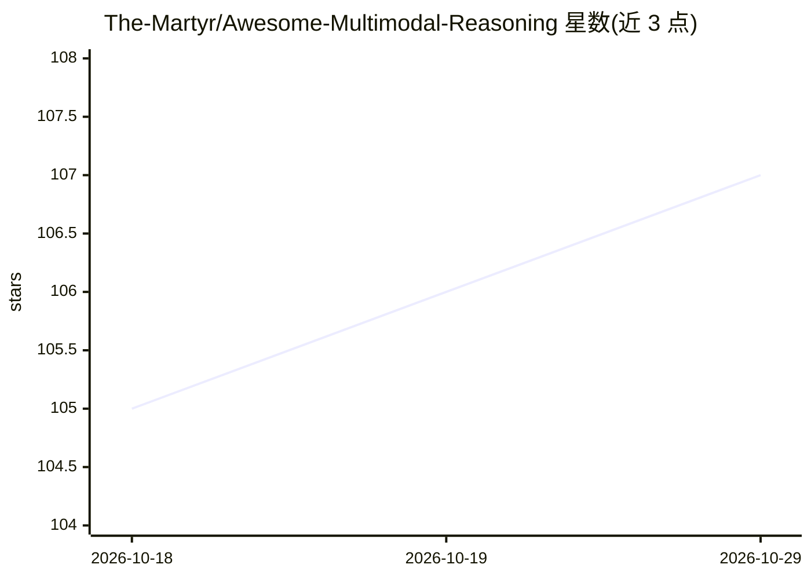

# The-Martyr/Awesome-Multimodal-Reasoning

⭐ 107 · MIT · 推送 2026-10-19 · [GitHub](https://github.com/The-Martyr/Awesome-Multimodal-Reasoning) · 个人维护

**多模态大模型推理与生成的论文清单（研究综述支持用）**

收录多模态大语言模型（图像、视频）推理相关论文的清单型仓库，条目按综述、图像推理等章节组织，每条含日期、标题与 arXiv 链接。范围覆盖基于强化学习的推理（RL/CoT）以及与 RL/CoT 结合的视觉生成（图像生成/视频生成）论文。仓库声明目标是覆盖所有可能相关论文以支持研究综述，而非仅精选论文。持续更新中。

## 筛选速览

| 维度 | 判定 | 备注 |
|---|---|---|
| AI 角色 | `ai-knowledge` | 知识聚合/清单类 |
| 许可风险 | `permissive` | MIT |
| 部署形态 | `None` |  |
| 模型依赖 | — | README 未给出锁定关系 |
| 硬件要求 | — | 无带数字的原话,不猜 |
| 安装摩擦 | `low` | 无编译、无系统依赖或容器化 |
| 成熟度 | — | 结构信号不足 |

## 能力要点

- 按 Survey、Image Reasoning 等类别组织的论文条目
- 覆盖 RL/CoT 驱动的多模态推理与视觉生成论文
- 声明全面覆盖所有相关论文以支持研究综述

## 适用场景

- 做多模态推理方向的文献综述时查找论文
- 跟踪 RL 驱动的多模态推理与生成最新论文
- 了解多模态大模型推理研究的子方向分布

## 场景标签

`精选清单` · 领域:学习与行业

## 证据(README 行号)

> L3: This is a repository for organizing papers related to Multimodal Reasoning in Multimodal Large Language Models (Imag
> L7: This repo also select paper about visual generation (image generation/video generation) with RL/CoT.
> L9: **This repository aims to cover ALL possibly relevant papers to support research surveys, not just selected best pap

## 星数曲线

2026-10-18 105 → 2026-10-29 107（+2）

---
*卡片 v1 · prompt 1.4 · 生成 2026-10-23 · 置信度 high · 依据 README sha `f5d5e263a379` · [字段定义](../../DATASET.md)*
