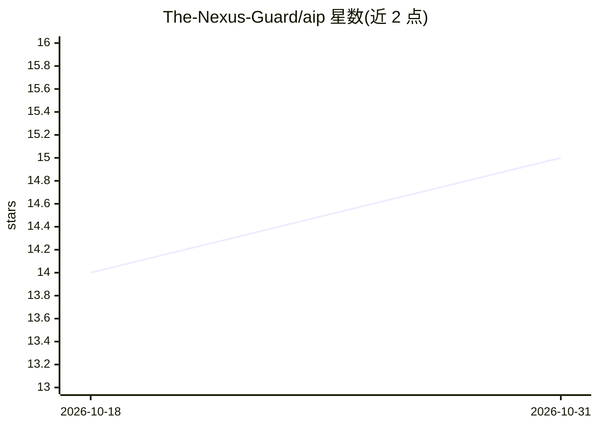

# The-Nexus-Guard/aip

⭐ 15 · Python · MIT · 推送 2026-03-22 · [GitHub](https://github.com/The-Nexus-Guard/aip) · [官网](https://the-nexus-guard.github.io/aip/) · 组织维护

**给 AI agent 的去中心化密码学身份、信任链与端到端加密消息协议**

面向多 agent 系统的身份与信任基础设施：以 Ed25519 密钥对为每个 agent 生成可验证的 DID 身份，支持挑战-响应验证、签名背书（vouch）构成的信任链与信任衰减评分、信任路径发现与撤销，并提供端到端加密消息（中继只见密文）。另含技能签名（skill.md 签名与 CODE_SIGNING 背书）、MCP 集成、LangChain/CrewAI/AutoGen 一行接入中间件、CI/CD 签名 GitHub Action 与完整 CLI。有纯 Python 零依赖实现，官方中继服务存在速率限制，旧消息签名格式已标记弃用。

## 筛选速览

| 维度 | 判定 | 备注 |
|---|---|---|
| AI 角色 | `ai-ecosystem` | LLM/agent 周边工具 |
| 许可风险 | `permissive` | MIT |
| 部署形态 | `library` | 以包/库形式分发 |
| 模型依赖 | — | README 未给出锁定关系 |
| 硬件要求 | — | 无带数字的原话,不猜 |
| 安装摩擦 | `low` | 无编译、无系统依赖或容器化 |
| 成熟度 | — | 结构信号不足 |

## 能力要点

- Ed25519 密钥对 + DID 的去中心化 agent 身份与挑战-响应验证
- 签名 vouch 信任链、信任衰减评分与 isnad 信任路径发现
- 端到端加密消息，中继服务只见加密内容
- 技能签名、MCP 集成与 CI/CD 信任门控部署

## 适用场景

- 为我的 agent 建立可验证的密码学身份并核验对方身份
- 在多 agent 协作中构建与查询可审计的信任链
- 让 agent 间通信端到端加密而不依赖平台
- 在 CI/CD 中对构建产物签名并按信任阈值门控部署

## 场景标签

`多智能体` `网络安全` · 领域:Agent 开发

## 证据(README 行号)

> L11: **AIP fixes this.** Ed25519 keypairs give each agent a provable identity. Signed vouches create verifiable trust ch
> L131: Add cryptographic identity to any Python agent framework with one line:
> L141: Works with LangChain, CrewAI, AutoGen, and any Python agent. See examples/frameworks/ for complete integration exa

## 星数曲线

2026-10-18 14 → 2026-10-31 15（+1）

---
*卡片 v1 · prompt 1.4 · 生成 2026-10-31 · 置信度 high · 依据 README sha `32a33ddb30b4` · [字段定义](../../DATASET.md)*
