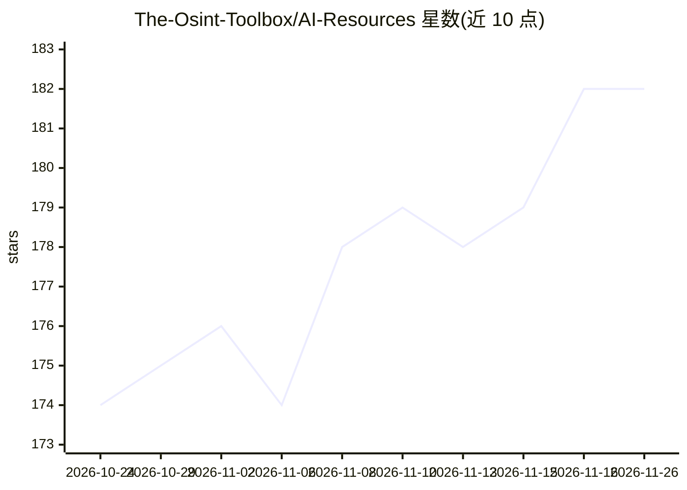

# The-Osint-Toolbox/AI-Resources

⭐ 182 · 推送 2026-11-15 · [GitHub](https://github.com/The-Osint-Toolbox/AI-Resources) · 个人维护

**面向 OSINT 调查者的 AI 工具清单**

按 OSINT 用途组织的 AI 工具链接清单，分七个板块：Deep Research、AI 反向图片搜索、AI OCR、AI 搜索引擎、AI 翻译、AI 杂项与 AI 小号工具。条目为一句话简介加外部链接，涵盖图像地理定位（Geospy、GeoInfer）、车牌/车辆图像搜索、本地 LLM（LM Studio、GPT4All）、转录与摘要等。开头提示使用 AI 做 OSINT 时的隐私风险与数据让渡问题。

## 筛选速览

| 维度 | 判定 | 备注 |
|---|---|---|
| AI 角色 | `ai-knowledge` | 知识聚合/清单类 |
| 许可风险 | `none` | — |
| 部署形态 | `None` |  |
| 模型依赖 | — | README 未给出锁定关系 |
| 硬件要求 | — | 无带数字的原话,不猜 |
| 安装摩擦 | `low` | 无编译、无系统依赖或容器化 |
| 成熟度 | — | 结构信号不足 |

## 能力要点

- 七个板块分类组织 OSINT 相关 AI 工具链接
- 收录多个 AI 图像地理定位工具（Geospy、GeoInfer、Picarta 等）
- 包含本地运行 LLM 的工具条目（LM Studio、GPT4All、Local AI）
- 提示使用 AI 工具时的隐私与数据风险

## 适用场景

- 做开源情报调查时查找图像地理定位工具
- 为调查报道寻找 AI 转录、翻译、搜索类工具
- 了解可用于 OSINT 的 AI 检测与抓取工具

## 场景标签

`精选清单` · 领域:学习与行业

## 证据(README 行号)

> L5:  Table of Contents
> L21:  Deep Research

## 星数曲线

2026-10-24 174 → 2026-11-26 182（+8）

---
*卡片 v1 · prompt 1.4 · 生成 2026-11-26 · 置信度 high · 依据 README sha `544b28186029` · [字段定义](../../DATASET.md)*
