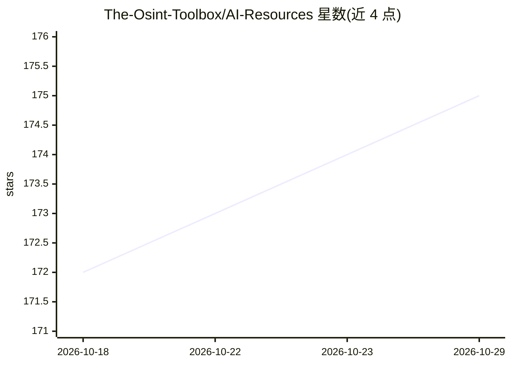

# The-Osint-Toolbox/AI-Resources

⭐ 175 · 推送 2026-04-05 · [GitHub](https://github.com/The-Osint-Toolbox/AI-Resources) · 个人维护

**面向 OSINT 调查者的 AI 工具分类清单**

一个策展式资源清单，收集可用于开源情报（OSINT）工作的 AI 工具，按深度研究、AI 反向图片搜索、AI OCR、AI 搜索引擎、AI 翻译、杂项与虚拟账号工具等类别组织。条目以外部链接加一句话简介形式列出，覆盖 Gemini、OpenAI、Geospy、Whisper、Perplexity 等。README 同时提示部分工具存在数据隐私顾虑。仓库本身不提供代码或安装方式。

## 筛选速览

| 维度 | 判定 | 备注 |
|---|---|---|
| AI 角色 | `ai-knowledge` | 知识聚合/清单类 |
| 许可风险 | `none` | — |
| 部署形态 | `None` |  |
| 模型依赖 | — | README 未给出锁定关系 |
| 硬件要求 | — | 无带数字的原话,不猜 |
| 安装摩擦 | `low` | 无编译、无系统依赖或容器化 |
| 成熟度 | — | 结构信号不足 |

## 能力要点

- 按深度研究/反向图搜/OCR/搜索/翻译等 7 个类别组织条目
- 收录 Geospy、Whisper、GPT4All 等数十个 AI 工具及一句话简介
- 开头提示使用 AI 工具的隐私与数据风险

## 适用场景

- 为 OSINT 调查挑选图片定位、OCR、转录类 AI 工具
- 按类别浏览调查可用的 AI 搜索与深度研究工具

## 场景标签

`精选清单` · 领域:学习与行业

## 证据(README 行号)

> L3:  AI is not new however it has recently taken a leap forward not just in technology but also public awareness. For th
> L5:  Table of Contents

## 星数曲线

2026-10-18 172 → 2026-10-29 175（+3）

---
*卡片 v1 · prompt 1.4 · 生成 2026-10-22 · 置信度 high · 依据 README sha `bced2c851acc` · [字段定义](../../DATASET.md)*
