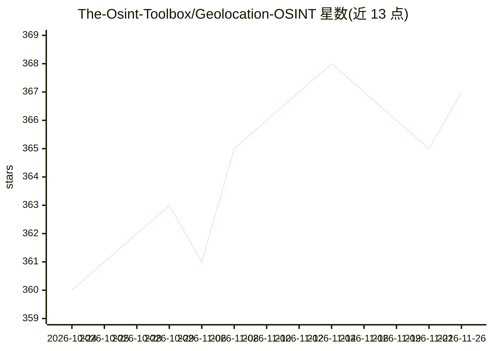

# The-Osint-Toolbox/Geolocation-OSINT

⭐ 367 · 推送 2026-11-14 · [GitHub](https://github.com/The-Osint-Toolbox/Geolocation-OSINT) · 个人维护

**地理定位 OSINT 资源清单：地图、街景、卫星等工具聚合**

面向地理定位（Geolocation）技能练习者（如 @quiztime 挑战参与者）的资源索引，按类别组织：地图与影像资源、英国专门资源、卫星资源、无人机资源。收录的条目涵盖通用地图平台（Google Maps、OpenStreetMap、Yandex Maps 等）、街景与社区影像（Mapillary、KartaView）、照片定位估算工具（GeoSpy、Picarta、Geo-Estimation）、阴影/太阳分析（ShadowFinder、SunCalc）以及卫星影像获取渠道（Copernicus、Google Earth Engine）。条目附一句功能描述与链接，本身不含安装或运行说明。

## 筛选速览

| 维度 | 判定 | 备注 |
|---|---|---|
| AI 角色 | `ai-knowledge` | 知识聚合/清单类 |
| 许可风险 | `none` | — |
| 部署形态 | `None` |  |
| 模型依赖 | — | README 未给出锁定关系 |
| 硬件要求 | — | 无带数字的原话,不猜 |
| 安装摩擦 | `low` | 无编译、无系统依赖或容器化 |
| 成熟度 | — | 结构信号不足 |

## 能力要点

- 地图与影像、英国专门、卫星、无人机四类资源分区组织
- 收录基于 AI 的照片定位工具条目（GeoSpy、Picarta、GeoInfer、Geo-Estimation）
- 包含 Bellingcat 开源调查工具（OSM 搜索、ShadowFinder、网格生成器）
- 覆盖街景、卫星影像、太阳阴影、邮政编码等多类定位线索来源

## 适用场景

- 参加 @quiztime 等地理定位挑战时查找可用工具
- 为照片定位线索检索街景与社区影像平台
- 查找特定区域（如英国邮编、伊朗地图）的专门资源
- 获取免费开放的卫星影像数据源

## 场景标签

`精选清单` · 领域:学习与行业

## 证据(README 行号)

> L3:  If you like your Geolocation challenges, @quiztime, try some of the below resources. You may also need Image search
> L7:  Maps & Image Resources
> L156:  UK Specific Resources
> L173:  Satellite Resources
> L200:  Drone Resources

## 星数曲线

2026-10-24 360 → 2026-11-26 367（+7）

---
*卡片 v1 · prompt 1.4 · 生成 2026-11-25 · 置信度 high · 依据 README sha `93b188a5e760` · [字段定义](../../DATASET.md)*
