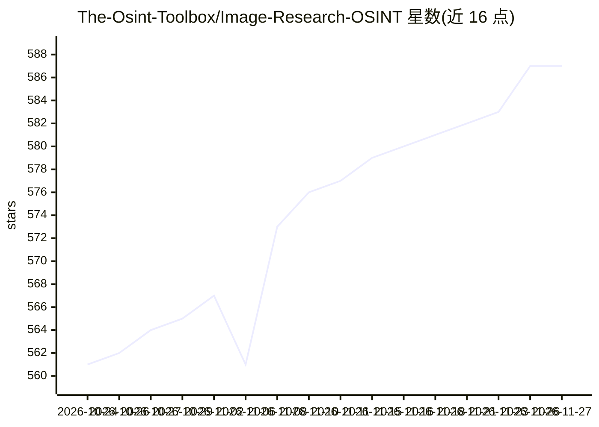

# The-Osint-Toolbox/Image-Research-OSINT

⭐ 587 · 推送 2026-11-22 · [GitHub](https://github.com/The-Osint-Toolbox/Image-Research-OSINT) · 组织维护

**图像调查 OSINT 工具与网站链接合集，教用户做图像研究**

一个按类别组织的链接清单，收录图像反向搜索、股票图库、人脸识别搜索、图像调查与 EXIF/取证工具、图像处理网站的入口及一句话说明，涵盖 AI 地理定位、AI 生成图像检测等条目。README 提醒向第三方网站上传图像可能涉及敏感信息泄露。本体为资源目录，不含安装步骤、代码或运行机制，收录条目为第三方托管服务与工具。

## 筛选速览

| 维度 | 判定 | 备注 |
|---|---|---|
| AI 角色 | `ai-knowledge` | 知识聚合/清单类 |
| 许可风险 | `none` | — |
| 部署形态 | `None` |  |
| 模型依赖 | — | README 未给出锁定关系 |
| 硬件要求 | — | 无带数字的原话,不猜 |
| 安装摩擦 | `low` | 无编译、无系统依赖或容器化 |
| 成熟度 | — | 结构信号不足 |

## 能力要点

- 按反向图搜/图库/人脸搜索/图像取证/图像处理五类组织链接
- 收录 AI 地理定位与 AI 生成图像检测类工具条目
- 每条附一句话功能说明与来源链接

## 适用场景

- 查找可对图片做反向搜索或溯源的在线工具
- 需要检测图片是否由 AI 生成时查找检测服务
- 调查图像 EXIF 元数据与伪造痕迹时定位工具

## 场景标签

`精选清单` · 领域:学习与行业

## 证据(README 行号)

> L3:  On this page you will find links to useful image search, investigation & manipulation websites and tools. Please re
> L5:  Reverse Image Search

## 星数曲线

2026-10-24 561 → 2026-11-27 587（+26）

---
*卡片 v1 · prompt 1.4 · 生成 2026-11-26 · 置信度 high · 依据 README sha `f59d6a84298e` · [字段定义](../../DATASET.md)*
