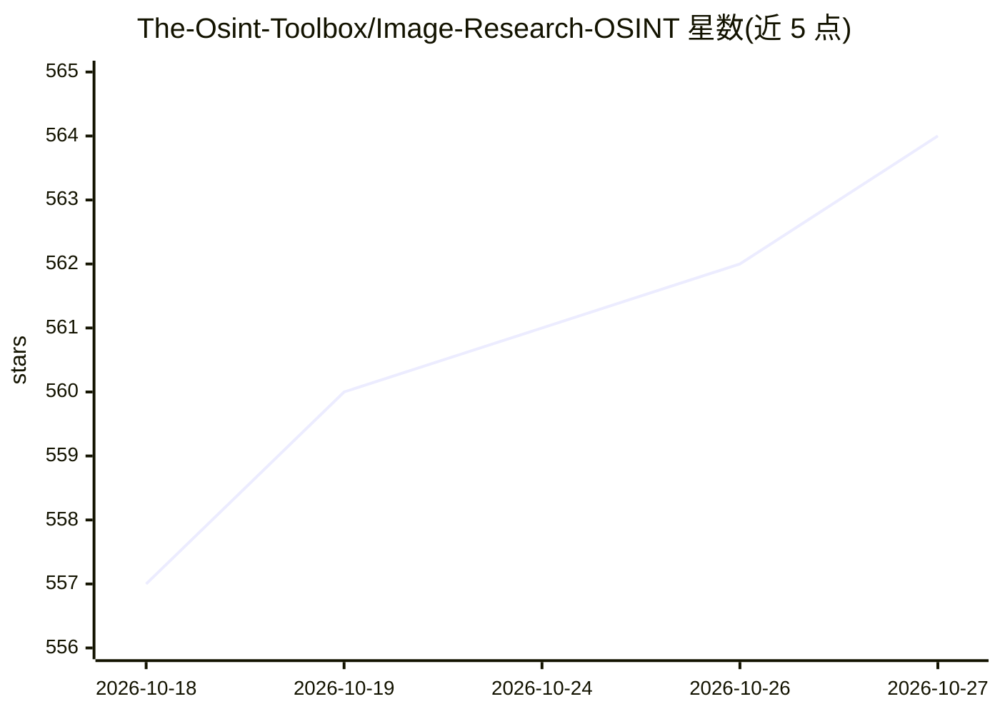

# The-Osint-Toolbox/Image-Research-OSINT

⭐ 564 · 推送 2026-07-12 · [GitHub](https://github.com/The-Osint-Toolbox/Image-Research-OSINT) · 个人维护

**图像调查 OSINT 工具链接清单：反向搜图/人脸识别/EXIF 取证**

一个纯链接式策展页面，汇总图像研究与调查类网站与工具，按四大类组织：反向图像搜索（约 50 项，含 Geospy、Picarta、Tineye 等，多标注为 AI 驱动）、图库图片搜索（Getty/Unsplash 等）、人脸识别搜索（PimEyes、Face++、Amazon Rekognition 等）、图像调查与篡改工具（EXIF 提取/编辑、AI 生成图检测、 forensic 工具、修图工具）。页面开头提示将图像上传第三方网站存在敏感数据进入数据集的风险。条目为链接加一行描述，无代码、无安装步骤。

## 筛选速览

| 维度 | 判定 | 备注 |
|---|---|---|
| AI 角色 | `ai-knowledge` | 知识聚合/清单类 |
| 许可风险 | `none` | — |
| 部署形态 | `None` |  |
| 模型依赖 | — | README 未给出锁定关系 |
| 硬件要求 | — | 无带数字的原话,不猜 |
| 安装摩擦 | `low` | 无编译、无系统依赖或容器化 |
| 成熟度 | — | 结构信号不足 |

## 能力要点

- 四类组织：反向搜图、图库搜索、人脸识别搜索、调查与修图工具
- 收录条目多与 AI 能力相关（AI 地理定位、AI 反向搜图、AI 生成图检测）
- 页面开头包含第三方上传图像的隐私风险提示

## 适用场景

- 调查一张图片的来源或首次出现时间
- 按人脸搜索某人在网络上的照片
- 提取图片 EXIF 元数据或检测 AI 生成图像
- 查找可用的图像取证与修图网站

## 场景标签

`精选清单` · 领域:学习与行业

## 证据(README 行号)

> L3:  On this page you will find links to useful image search, investigation & manipulation websites and tools. Please re
> L5:  Reverse Image Search

## 星数曲线

2026-10-18 557 → 2026-10-27 564（+7）

---
*卡片 v1 · prompt 1.4 · 生成 2026-10-21 · 置信度 high · 依据 README sha `50f1d2bb967e` · [字段定义](../../DATASET.md)*
