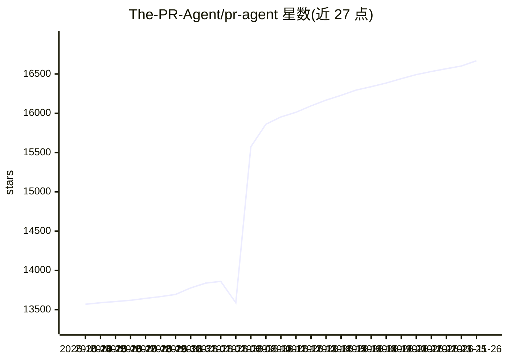

# The-PR-Agent/pr-agent

⭐ 16,668 · Python · MIT · 推送 2026-11-25 · [GitHub](https://github.com/The-PR-Agent/pr-agent) · [官网](https://www.pr-agent.ai) · 组织维护

**面向开发团队的 AI 代码审查 Agent，自动化 PR 评审与描述生成**

PR-Agent 是一个开源的 AI 代码审查代理，通过在 PR 上评论或 CLI 调用命令（/describe、/review、/improve、/ask 等）自动生成 PR 描述、执行代码审查与改进建议。采用 PR 压缩策略处理大小 PR，支持 JSON 配置自定义提示词。可通过 GitHub Action、CLI、Docker、webhook 等方式部署，支持 GitHub、GitLab、BitBucket、Azure DevOps、Gitea 平台。该项目原为 Qodo 开源项目，现已捐赠给社区维护；注意其与 Qodo 商业产品是不同的项目。/help_docs 功能自 v0.36.1 起临时停用。

## 筛选速览

| 维度 | 判定 | 备注 |
|---|---|---|
| AI 角色 | `ai-native` | 本体是模型或模型工具 |
| 许可风险 | `permissive` | MIT |
| 部署形态 | `desktop` | 安装包/桌面程序 |
| 模型依赖 | local-ok | 支持本地模型 |
| 硬件要求 | — | 无带数字的原话,不猜 |
| 安装摩擦 | `low` | 无编译、无系统依赖或容器化 |
| 成熟度 | — | 结构信号不足 |

## 动量与使用信号

- 维护:`active` — 距上次 push 0.7 天,年发版 23,393 位贡献者
- 涨星:近 1 天 **+17**(自 20261016 起算)
- 平台:— · 协议:OPENAI-API / OLLAMA

## 能力要点

- PR 评论命令式交互：/describe、/review、/improve 等命令
- PR Compression 策略处理任意大小的 PR
- 支持 GitHub/GitLab/BitBucket/Azure DevOps/Gitea 多平台
- JSON 配置文件自定义审查类别与行为

## 适用场景

- 在 GitHub 仓库中通过 Action 自动审查每个 PR
- 本地开发时用 CLI 快速分析某个 PR
- 自托管部署以掌控代码数据与基础设施

## 场景标签

`代码审查` · 领域:编码与开发

## 证据(README 行号)

> L33: PR-Agent is an open-source, AI-powered code review agent and a community-maintained legacy project of Qodo. It is d
> L94: - **AI Models**: OpenAI GPT, Anthropic Claude, Google Gemini, DeepSeek, Mistral, and any other model reachable thro

## 星数曲线

2026-10-24 13,569 → 2026-11-26 16,668（+3,099）

---
*卡片 v1 · prompt 1.4 · 生成 2026-11-22 · 置信度 high · 依据 README sha `b3f137b0ad16` · [字段定义](../../DATASET.md)*
