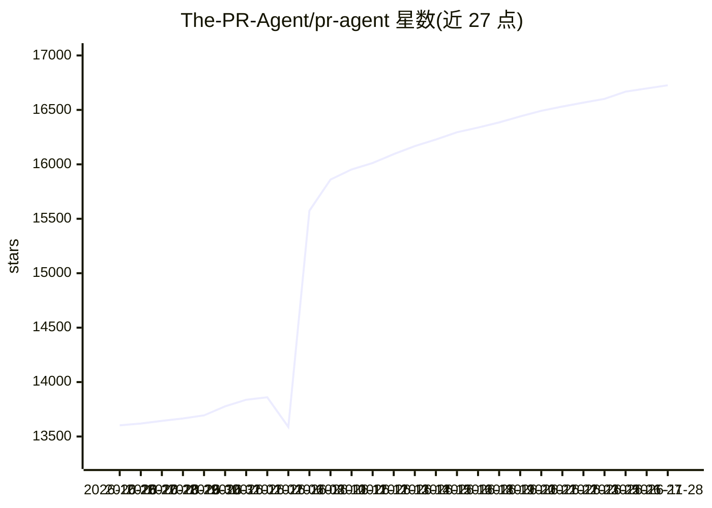

# The-PR-Agent/pr-agent

⭐ 16,726 · Python · MIT · 推送 2026-11-27 · [GitHub](https://github.com/The-PR-Agent/pr-agent) · [官网](https://www.pr-agent.ai) · 组织维护

**AI 驱动的开源 PR 代码审查 agent，供开发团队自动化审查拉取请求**

PR-Agent 是一个开源的 AI 代码审查 agent，原为 Qodo 项目，现已捐赠给社区维护。通过在 PR 上评论 /describe、/review 等命令或在 CLI 运行，调用 LLM 生成 PR 描述与审查意见；采用 PR Compression 策略处理大小 PR，支持基于 JSON 的提示词自定义。部署方式覆盖 CLI、GitHub Actions、Docker、webhook 与自托管，支持 GitHub、GitLab、BitBucket、Azure DevOps、Gitea 五类 Git 平台。注意 /help_docs 自 v0.36.1 起因凭证泄露问题临时停用。

## 筛选速览

| 维度 | 判定 | 备注 |
|---|---|---|
| AI 角色 | `ai-native` | 本体是模型或模型工具 |
| 许可风险 | `permissive` | MIT |
| 部署形态 | `desktop` | 安装包/桌面程序 |
| 模型依赖 | — | README 未给出锁定关系 |
| 硬件要求 | — | 无带数字的原话,不猜 |
| 安装摩擦 | `low` | 无编译、无系统依赖或容器化 |
| 成熟度 | — | 结构信号不足 |

## 动量与使用信号

- 维护:`active` — 距上次 push 0.7 天,年发版 23,393 位贡献者
- 涨星:近 1 天 **+17**(自 20261016 起算)
- 平台:— · 协议:OPENAI-API / OLLAMA

## 能力要点

- PR 评论命令式交互：/describe、/review、/ask 等
- PR Compression 策略处理任意规模的 PR
- 通过 LiteLLM 接入多种模型（OpenAI、Claude、Gemini、Ollama 等）
- 多平台部署：CLI、GitHub Actions、Docker、webhook、自托管

## 适用场景

- 在 GitHub 仓库中通过 Action 自动审查每个 PR
- 自托管以掌控代码数据与基础设施
- 按团队需求自定义审查类别与提示词行为

## 场景标签

`代码审查` · 领域:编码与开发

## 证据(README 行号)

> L33: PR-Agent is an open-source, AI-powered code review agent and a community-maintained legacy project of Qodo. It is d
> L94: - **AI Models**: OpenAI GPT, Anthropic Claude, Google Gemini, DeepSeek, Mistral, and any other model reachable thro

## 星数曲线

2026-10-26 13,603 → 2026-11-28 16,726（+3,123）

---
*卡片 v1 · prompt 1.4 · 生成 2026-11-27 · 置信度 high · 依据 README sha `8e70234ee14c` · [字段定义](../../DATASET.md)*
