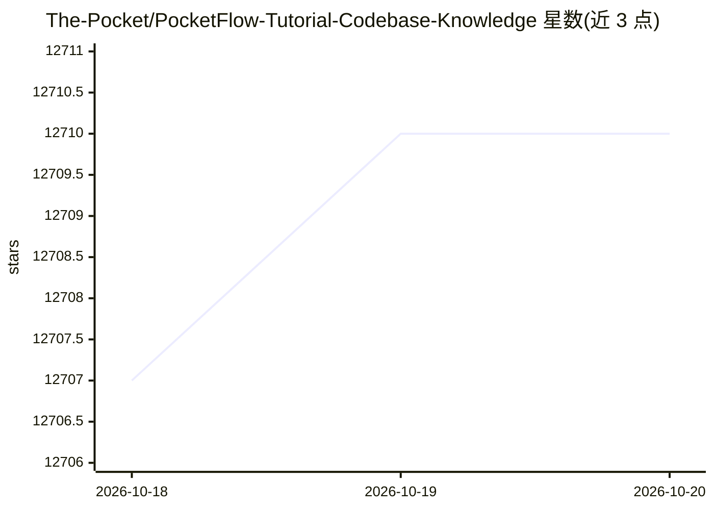

# The-Pocket/PocketFlow-Tutorial-Codebase-Knowledge

⭐ 12,710 · Python · MIT · 推送 2026-05-31 · [GitHub](https://github.com/The-Pocket/PocketFlow-Tutorial-Codebase-Knowledge) · [官网](https://code2tutorial.com/ ) · 个人维护

**将 GitHub 代码库转化为新手教程的 AI 教程项目**

Pocket Flow（100 行 LLM 框架）的教程项目：通过 AI agent 爬取 GitHub 仓库或读取本地目录，构建代码知识库，识别核心抽象及其交互，并生成带可视化、面向新手的教程文档。支持通过环境变量配置不同 LLM 提供商（默认 Gemini，可选 Ollama 等），提供 include/exclude 文件过滤、输出语言、抽象数量等参数，并以 git clone + pip 或 Docker 两种方式运行，产出保存至 output 目录。

## 筛选速览

| 维度 | 判定 | 备注 |
|---|---|---|
| AI 角色 | `ai-knowledge` | 知识聚合/清单类 |
| 许可风险 | `permissive` | MIT |
| 部署形态 | `self-host` | docker 或自建部署 |
| 模型依赖 | local-ok | 支持本地模型 |
| 硬件要求 | — | 无带数字的原话,不猜 |
| 安装摩擦 | `low` | 无编译、无系统依赖或容器化 |
| 成熟度 | — | 结构信号不足 |

## 能力要点

- 爬取 GitHub 仓库或分析本地目录构建代码知识库
- LLM 识别核心抽象并生成多语言教程（默认英语）
- 支持文件包含/排除过滤与文件大小上限
- 提供 Docker 运行方式，API key 以环境变量传入

## 适用场景

- 接手陌生代码库时快速生成入门讲解文档
- 为自己的开源项目生成面向新手的教程
- 用本地 Ollama 模型离线分析代码库

## 场景标签

`教程课程` `AI 写作` · 领域:内容生成

## 证据(README 行号)

> L7: > *Ever stared at a new codebase written by others feeling completely lost? This tutorial shows you how to build an 
> L13: This is a tutorial project of Pocket Flow, a 100-line LLM framework. It crawls GitHub repositories and builds a kno

## 星数曲线

2026-10-18 12,707 → 2026-10-20 12,710（+3）

---
*卡片 v1 · prompt 1.4 · 生成 2026-10-20 · 置信度 high · 依据 README sha `18969315ce80` · [字段定义](../../DATASET.md)*
