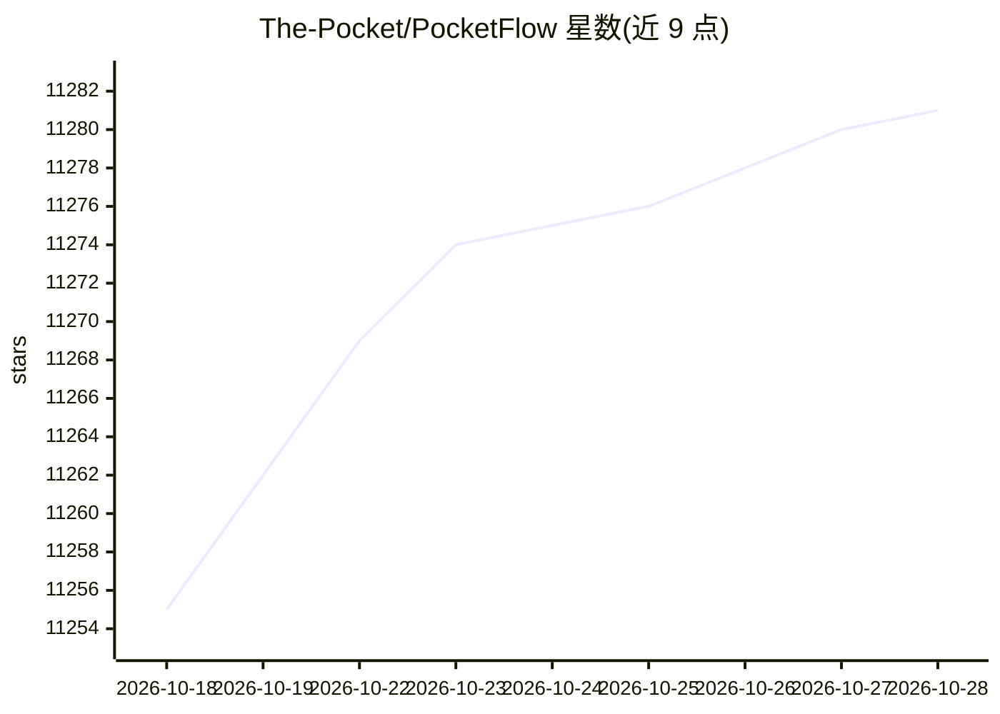

# The-Pocket/PocketFlow

⭐ 11,285 · Python · MIT · 推送 2026-07-26 · [GitHub](https://github.com/The-Pocket/PocketFlow) · [官网](https://the-pocket.github.io/PocketFlow/) · 个人维护 · 中文 README

**100 行代码的极简 LLM 框架：用图抽象构建 Agent 与工作流**

以 100 行代码实现 LLM 框架核心抽象（Graph）的 Python 极简框架，零依赖、无应用级与厂商级封装，在此之上可实现 (Multi-)Agent、Workflow、RAG、Map-Reduce、Streaming 等设计模式。提供 30 余个分层教程（从基础 Chat 到生产级 Coding Agent）及多个完整 LLM 应用示例，支持 Agentic Coding 范式（人类设计、Agent 编码），并有 TypeScript、Java、C++、Go、Rust、PHP 版本。MIT 许可。

## 筛选速览

| 维度 | 判定 | 备注 |
|---|---|---|
| AI 角色 | `ai-ecosystem` | LLM/agent 周边工具 |
| 许可风险 | `permissive` | MIT |
| 部署形态 | `library` | 以包/库形式分发 |
| 模型依赖 | — | README 未给出锁定关系 |
| 硬件要求 | — | 无带数字的原话,不猜 |
| 安装摩擦 | `low` | 无编译、无系统依赖或容器化 |
| 成熟度 | — | 结构信号不足 |

## 能力要点

- 核心代码仅 100 行，零依赖、零厂商锁定
- 以 Graph 抽象支撑 Agent、Workflow、RAG 等设计模式
- 提供 30+ 分层教程与多个完整 LLM 应用示例
- 另有 TypeScript/Java/C++/Go/Rust/PHP 六种语言版本

## 适用场景

- 学习 LLM 框架的核心抽象与设计模式实现
- 以 Agentic Coding 方式快速搭建 Agent 应用
- 作为轻量底座在其上构建 RAG、工作流、多 Agent 系统

## 场景标签

`Agent 框架` `教程课程` · 领域:Agent 开发

## 证据(README 行号)

> L11: Pocket Flow is a 100-line minimalist LLM framework
> L40: The 100 lines capture the core abstraction of LLM frameworks: Graph!
> L42: From there, it's easy to implement popular design patterns like (Multi-)Agents, Workflow, RAG, etc.

## 星数曲线

2026-10-18 11,255 → 2026-10-28 11,281（+26）

---
*卡片 v1 · prompt 1.4 · 生成 2026-10-20 · 置信度 high · 依据 README sha `9014f6111322` · [字段定义](../../DATASET.md)*
